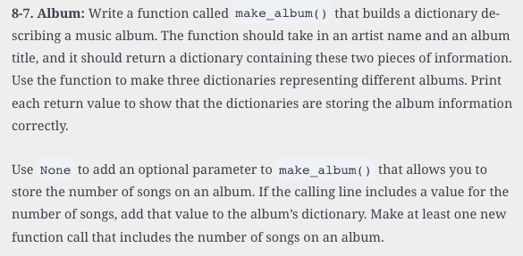

#  Reading: Functions and Files

---

## Pre Class Reading Assignment

Re-read the chapter on Python Functions in the _Python Crash Course, 3rd Edition_ textbook, paying particular attention to passing lists to functions, passing an arbitrary number of arguments, and storing functions in modules.
</br>Here is a direct link to the previous reading: [PCC Chapter 8: Functions](https://learning.oreilly.com/library/view/python-crash-course/9781098156664/c08.xhtml){:target="_blank"}.

Also read the Files section below.

### Things to Look Out For
- Python functions take inputs (parameters), process them, and return outputs (return values).
- Functions let you reuse code by calling the same block multiple times. 
- Parameters are placeholders in function definitions; arguments are actual values passed during function calls.
- Functions can take many arguments; if the number is uncertain, use flexible syntax (*args, **kwargs).
- You can pass arguments by position or with key = value, and even pass lists to functions.
- Modules let you import and reuse Python code across programs.

---

## Files 

This section will introduce you to file handling in Python. You will learn how to read from and write to files, which is essential for data persistence and manipulation.

Chapter 10 of the _Python Crash Course, 3rd Edition_ textbook covers file handling in Python. You can read the chapter here: [PCC Chapter 10: Files and Exceptions](https://learning.oreilly.com/library/view/python-crash-course/9781098156664/c10.xhtml){:target="_blank"}.

### Getting Files In and Out of Colab

Colab does not run on your computer. It runs on a temporary machine in the cloud, and your notebook talks to that machine through your browser. This matters as soon as you start working with files: when your code calls `open('example.txt')`, Python looks for that file on the cloud machine, not in your Downloads folder.

So there are two extra steps around any file work you do in this class:

- A file your program needs to **read** must first be **uploaded** to the session.
- A file your program **creates** exists only on the cloud machine, so you must **download** it if you want a copy.

#### Uploading a File

1. Click the folder icon on the left edge of the Colab window to open the **Files** panel.
2. Click the **Upload to session storage** button at the top of the panel, or drag the file from your computer directly into the panel.
3. The file appears in the list, in a folder called `content`. That is the folder your code starts in, so `open('example.txt')` will find it without you typing any folder path.

You can also upload with code. Running this cell gives you a **Choose Files** button that opens a file picker on your own computer:

```python
from google.colab import files
uploaded = files.upload()
```

The file you pick is placed in the same `content` folder as a drag-and-drop upload, so your code still opens it by name alone.

#### Downloading a File

When your code writes a file, that file is created on the cloud machine alongside your uploads.

1. Open the **Files** panel.
2. Click the refresh icon if your new file is not listed yet. Files your code creates do not always appear right away.
3. Click the three dots to the right of the file name and choose **Download**.

Colab hands the file to your browser, exactly as if you had clicked a download link on a web page, so it lands wherever your browser saves downloads. On most computers that is the **Downloads** folder. If your browser is set to ask where to save each file, you will get a dialog instead. The file keeps the name it had in Colab.

Just like your notebooks, move the downloaded file into your CCE 270 folder afterward so you can find it again.

You can also download with code, which saves the file to that same place:

```python
from google.colab import files
files.download('output.txt')
```

!!! tip "If nothing seems to happen"
    Browsers sometimes block a download that a script starts rather than a person clicking. If you run `files.download()` and no file arrives, look for a blocked-popup icon in your address bar and allow popups for `colab.research.google.com`, or use the **Files** panel method above instead.

!!! warning "Session storage is temporary"
    Files you upload and files your code creates are erased when your Colab session ends or the runtime restarts, and they are **not** saved inside your notebook. If you close Colab and come back later, or use **Runtime | Restart session**, you will need to upload your input files again and re-run your code to recreate your output files. Download anything you want to keep.

### Opening a File

To read or open a file in Python, you can use the built-in `open()` function. The `open()` function takes two arguments: the name of the file and the mode in which you want to open the file. The most common modes are:


- `'r'`: Read mode (default). Opens the file for reading.

- `'w'`: Write mode. Opens the file for writing (creates a new file or overwrites (truncates) an existing file).

- `'a'`: Append mode. Opens the file for appending (creates a new file if it doesn't exist).


There are two main ways that you can open and close a file in Python:

1. Using the `open()` function without a context manager, which requires you to manually close the file using the `close()` method. 
2. Using the `open()` function with a context manager (`with` statement), which automatically closes the file when you're done with it.

#### Without Using a Context Manager

```python
file = open('example.txt', 'r')
content = file.read()
print(content)
file.close()
```

In this example, the file `example.txt` is opened in read mode. You must remember to call `file.close()` to close the file after you're done with it. If you forget to close the file, it can lead to resource leaks and other issues.

#### Using a Context Manager

```python
with open('example.txt', 'r') as file:
    content = file.read()
    print(content)
```

In this example, the file `example.txt` is opened in read mode. The `with` statement ensures that the file is properly closed after its suite finishes, even if an exception is raised. This method is preferred for file handling in Python because it is cleaner and less error-prone (you're less likely to forget to close the file).

### Reading a file 
Reading a Python file means that you are accessing the contents of the file and loading it into your program so that you can manipulate or analyze the data. Note: When you read a file (the -r option), you are not modifying the file itself, you are simply accessing its contents. This is especially useful when working with large datasets or text files, as it allows you to process the data without having to load the entire file into memory at once. You can read in the entire file (like the examples in the Context manager section), or you can read in things line by line.

```python
with open('example.txt', 'r') as file:
    for line in file:
        print(line.strip())
```

In this example, the file `example.txt` is opened in read mode. The `for` loop iterates over each line in the file, and the `strip()` method is used to remove any leading or trailing whitespace (including newline characters) before printing the line.

### Writing to a File

To write to a file in Python, you can use the `open()` function with the `'w'` or `'a'` mode.

```python
with open('output.txt', 'w') as file:
    file.write('Hello, World!\n')
    file.write('This is a new line.\n')
```

In this example, the file `output.txt` is opened in write mode. If the file already exists, it will be truncated (emptied). If it doesn't exist, a new file will be created. The `write()` method is used to write strings to the file.

### Appending to a File

```python
with open('output.txt', 'a') as file:
    file.write('This line is appended.\n')
```

In this example, the file `output.txt` is opened in append mode. If the file doesn't exist, a new file will be created. The `write()` method is used to append strings to the end of the file. The \n character is used to create a new line after each write. This is useful when you want to add new data to an existing file without overwriting the current contents.

---

## Pre-Class Quiz Challenge
In a Colab notebook, complete Problem 8-7 found in chapter 8 of the textbook. Download the completed notebook with **File | Download | Download .ipynb** and upload it with your Pre-Class Quiz. 



---

## Turning in/Rubric

**_REMINDER_** - For this class, **you will download your completed Colab notebook and upload the `.ipynb` file to Learning Suite**. Make sure the notebook you upload is for the correct assignment and contains your finished work.

**Rubric:**

|                      Item                      | Points Possible |
|:----------------------------------------------:|:---------------:|
| <div style="text-align: right">**Total**</div> |        3        |

---

The following is not a part of the rubric, but specifies how you can lose points. For example: if you fail to upload your file correctly.

| **Reasons for Points Lost** |    **Amount**     |  
|:---------------------------:|:-----------------:|
|  File uploaded incorrectly  |       -10%        | 