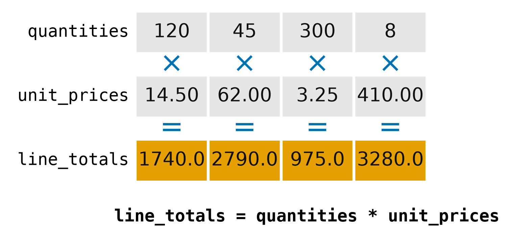
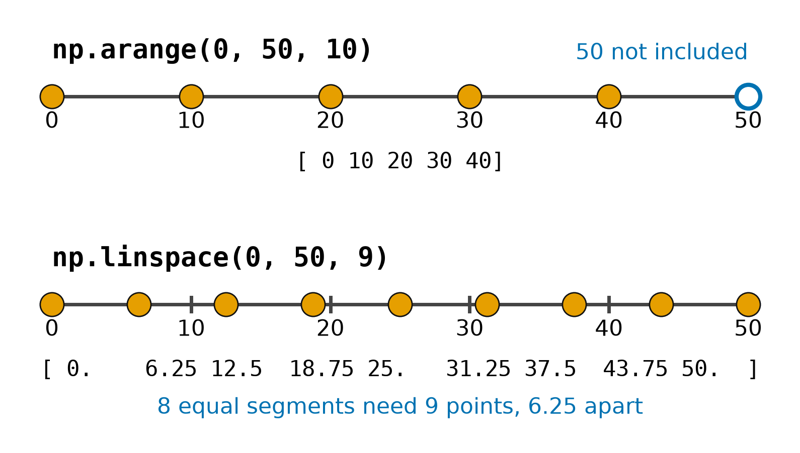
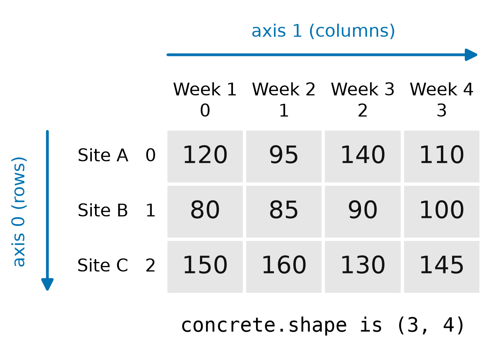
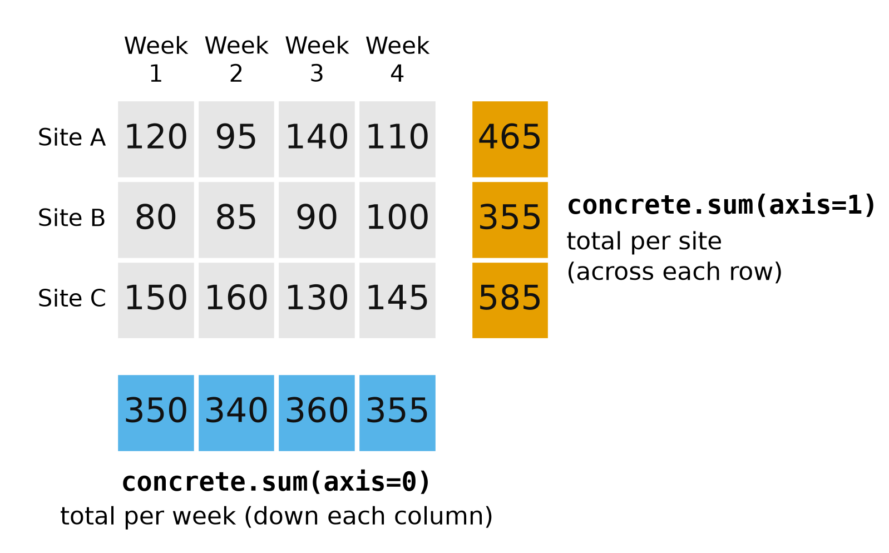
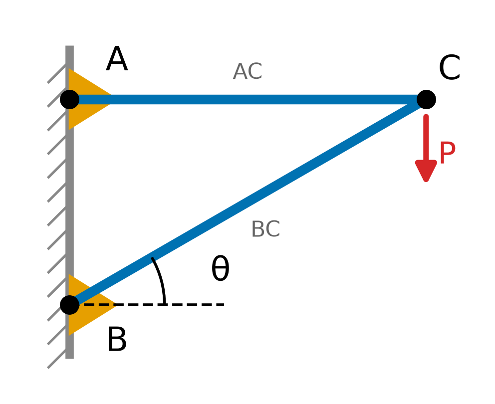
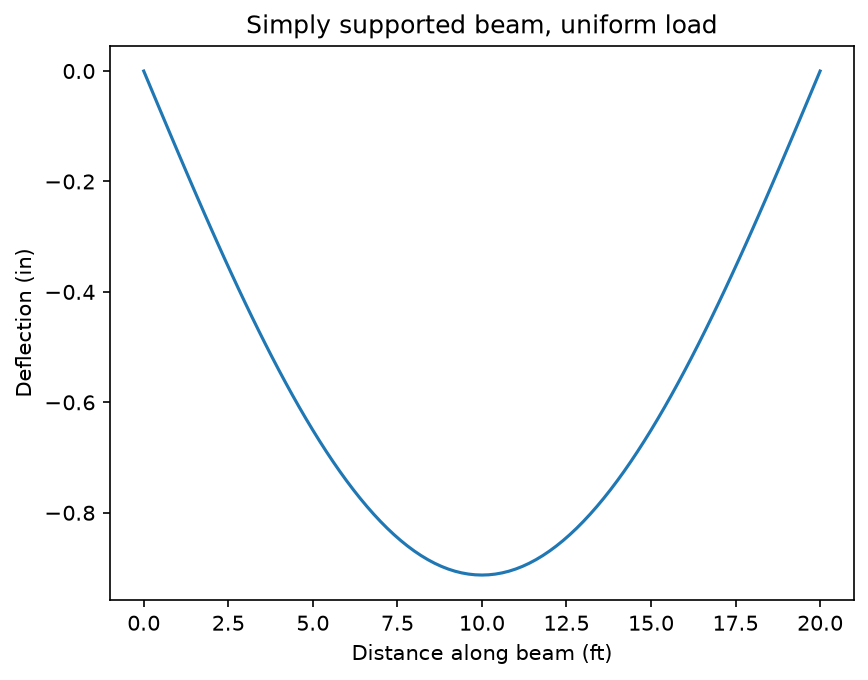

# NumPy: Working with Arrays of Numbers

Engineers and construction managers spend much of their time with columns of numbers: survey elevations, cylinder break strengths, daily streamflow, quantities from a takeoff, invoice line items, activity durations. In Unit 2 you stored numbers like these in Python lists and used loops to do math on them. NumPy, short for *Numerical Python*, adds a new data type, the *array*. An array holds a sequence of numbers, like a Python list, but it can do math on every value at once. Most Python tools for data and engineering analysis are built on it, including Matplotlib and pandas, the next two topics in this unit.

In this chapter you'll learn to create arrays, do math with them, pick values out of them, summarize them, and use them to solve systems of equations like the ones you'll set up for a truss.

## Why NumPy?

### From Loops to One Line

Say you need to add a change order to a project's planned quantities. In Unit 2 you'd add the two Python lists item by item with a loop:

```python
planned = [120, 45, 300, 8]
change_orders = [10, -5, 25, 0]

revised = []
for i in range(len(planned)):
    revised.append(planned[i] + change_orders[i])
print(revised)
```

```text
[130, 40, 325, 8]
```

With NumPy, the same job takes one line:

```python
import numpy as np

revised = np.array(planned) + np.array(change_orders)
print(revised)
```

```text
[130  40 325   8]
```

NumPy adds the first values together, then the second values, and so on, without a loop you have to write. Doing math on a whole array at once is called *vectorization*. Many problems that needed a loop in Unit 2 become one line:

| Task | Unit 2: loop over a Python list | NumPy: one line |
|:--|:--|:--|
| Average of five cylinder breaks | Add each value to a total, then divide by the count | `np.mean(strengths)` |
| Line totals on an invoice | Multiply each quantity by its unit price | `quantities * unit_prices` |
| Convert lengths from feet to meters | Multiply each length by 0.3048 | `lengths_ft * 0.3048` |
| Largest value | Keep track of the biggest value seen so far | `np.max(strengths)` |

You'll see how each of these works in [Math on a Whole Array](#math-on-a-whole-array) and [Summarizing Data](#summarizing-data).

### Faster, Too

Vectorized code also runs faster, because NumPy does its looping in compiled C code instead of running Python one line at a time. This example, which you'll run in class, adds two arrays of one million random numbers, first with NumPy and then with a loop. In Colab, `%timeit` runs a line many times and reports the average time. `np.zeros()` and `np.random.rand()` are explained later in this chapter; for now, compare the two times:

```python
def plusarray(x1, x2):
    x3 = np.zeros(len(x1))
    for i in range(len(x1)):
        x3[i] = x1[i] + x2[i]
    return x3

x4 = np.random.rand(1000000)
x5 = np.random.rand(1000000)

print('Numpy vectorization')
%timeit x4 + x5
print('Function using loops')
%timeit plusarray(x4, x5)
```

```text
Numpy vectorization
3.81 ms ± 457 µs per loop (mean ± std. dev. of 7 runs, 100 loops each)
Function using loops
546 ms ± 84.3 ms per loop (mean ± std. dev. of 7 runs, 1 loop each)
```

Your times will differ, but the loop is usually more than 100 times slower. With 4 invoice lines you won't notice. You will notice with a large data set, or with a simulation that runs thousands of times, like the one later in this chapter.

### A Large Library of Math Functions

NumPy also has hundreds of math functions that work on whole arrays. Here are some you'll use often, grouped the way the NumPy documentation groups them. Each heading links to the full list:

- [**Trigonometry**](https://numpy.org/doc/stable/reference/routines.math.html#trigonometric-functions): `np.sin()`, `np.cos()`, `np.tan()`, `np.arctan()`, `np.radians()`, `np.degrees()`
- [**Powers, roots, and logarithms**](https://numpy.org/doc/stable/reference/routines.math.html#exponents-and-logarithms): `np.sqrt()`, `np.exp()`, `np.log()`, `np.log10()`
- [**Rounding**](https://numpy.org/doc/stable/reference/routines.math.html#rounding): `np.round()`, `np.floor()`, `np.ceil()`
- [**Sums and differences**](https://numpy.org/doc/stable/reference/routines.math.html#sums-products-differences): `np.sum()`, `np.cumsum()`, `np.diff()`
- [**Statistics**](https://numpy.org/doc/stable/reference/routines.statistics.html): `np.mean()`, `np.median()`, `np.std()`, `np.percentile()`
- [**Linear algebra**](https://numpy.org/doc/stable/reference/routines.linalg.html): `np.linalg.solve()`, `np.linalg.inv()`, `np.linalg.det()`
- [**Creating arrays**](https://numpy.org/doc/stable/reference/routines.array-creation.html): `np.zeros()`, `np.arange()`, `np.linspace()`
- [**Random numbers**](https://numpy.org/doc/stable/reference/random/index.html): `np.random.rand()`, `np.random.randint()`, `np.random.normal()`
- [**Sorting and searching**](https://numpy.org/doc/stable/reference/routines.sort.html): `np.sort()`, `np.argsort()`, `np.argmax()`

When you need something this chapter doesn't cover, such as a hyperbolic cosine for a hanging cable or the 85th-percentile speed from a traffic study, look in these lists first.

### Following Along

Open a new notebook in Google Colab and run each example as you read. Examples within a section build on each other, so run them in order. Each section starts over with `import numpy as np`. After each **Try It Yourself** box, sample solutions are hidden in a collapsed block. Try the exercises before you open it.

## Importing NumPy

Every program that uses NumPy starts with this line:

```python
import numpy as np
```

The `as np` part gives NumPy a short nickname, so you can write `np.mean()` instead of `numpy.mean()`. Books, the NumPy documentation, and AI coding tools all use `np`, so you should too. Put the import in the first cell of your notebook and run it before anything else. If you see `NameError: name 'np' is not defined`, the import hasn't run yet.

## From Lists to Arrays

An array looks a lot like a Python list: an ordered sequence of values that you can index and slice. Three differences make it useful for engineering and construction work:

- Every value in an array has the same type, usually all whole numbers or all decimals.
- Math operators and NumPy functions work on the whole array at once.
- Arrays are stored compactly, so math on large arrays is fast.

A Python list is more flexible. It can hold a mix of numbers, strings, and other lists, and it can grow with `append()`. Keep using lists for things like activity names, and use arrays for numbers you want to calculate with.

To make an array, pass a Python list to `np.array()`. NumPy copies the values into a new array and leaves the list unchanged. Here are the 28-day strengths of five concrete cylinders:

```python
import numpy as np

strengths = [4210, 3980, 4450, 4120, 3890]    # psi
strengths_array = np.array(strengths)

print(strengths)
print(strengths_array)
print(type(strengths_array))
```

```text
[4210, 3980, 4450, 4120, 3890]
[4210 3980 4450 4120 3890]
<class 'numpy.ndarray'>
```

The Python list prints with commas and the array prints without them, which is the quickest way to tell which one you have. `type()` tells you for sure. `ndarray` stands for *n-dimensional array*. `len()` works on arrays the same way it does on lists: `len(strengths_array)` is 5. To turn an array back into a Python list, use its `tolist()` method: `strengths_array.tolist()`.

!!! warning "Pitfall: square brackets inside the parentheses"
    `np.array()` takes one Python list, so the values need square brackets: `np.array([1, 2, 3])`. Leaving them out, as in `np.array(1, 2, 3)`, gives `TypeError: array() takes from 1 to 2 positional arguments but 3 were given`.

### One Type per Array

Because every value in an array has the same type, NumPy has to choose one when you mix them. If you mix whole numbers and decimals, NumPy stores all of them as decimals, called *floats*:

```python
depths = np.array([1.5, 2, 3, 4.25])    # soil boring depths, ft
print(depths)
print(depths.dtype)
```

```text
[1.5  2.   3.   4.25]
float64
```

The `dtype` (data type) attribute tells you what kind of values an array holds. `float64` is a decimal number and `int64` is a whole number; the 64 is the number of bits used to store each value. The 2 became `2.`, which is how NumPy prints a float with nothing after the decimal point.

!!! warning "Pitfall: whole-number arrays drop decimals"
    An array made from whole numbers stays a whole-number array. If you put a decimal into it later, NumPy drops everything after the decimal point, with no warning:

    ```python
    counts = np.array([120, 135, 128])
    counts[0] = 121.7
    print(counts)
    ```

    ```text
    [121 135 128]
    ```

    If an array will hold decimals, create it with at least one decimal, such as `120.0`, or add `dtype=float`: `np.array([120, 135, 128], dtype=float)`.

## Math on a Whole Array

The introduction showed that arrays do math on every value at once. Here are the rules.

### An Array and a Single Number

When you combine an array with a single number, NumPy applies the number to every value. All the arithmetic operators work this way:

```python
import numpy as np

start_day = np.array([0, 5, 12, 20, 28])    # activity start days
print(start_day + 3)                         # every activity slips 3 days

rod_readings = np.array([4.52, 6.18, 3.07, 5.66])    # level rod readings, ft
height_of_instrument = 4525.82                        # ft
print(height_of_instrument - rod_readings)            # ground elevations, ft

lengths_ft = np.array([10, 12.5, 20])
print(lengths_ft * 0.3048)    # feet to meters
print(lengths_ft / 2)         # distance to midspan, ft
print(lengths_ft ** 2)        # each length squared
```

```text
[ 3  8 15 23 31]
[4521.3  4519.64 4522.75 4520.16]
[3.048 3.81  6.096]
[ 5.    6.25 10.  ]
[100.   156.25 400.  ]
```

In a level survey, each ground elevation is the height of the instrument minus the rod reading, so one line gives all four elevations. The single number can go on either side of the operator.

### Two Arrays of the Same Length

When you combine two arrays of the same length, NumPy pairs the first value with the first value, the second with the second, and so on. This is called an *element-wise* operation. To get the line totals on a supplier's invoice, multiply each quantity by its unit price:

```python
quantities = np.array([120, 45, 300, 8])
unit_prices = np.array([14.50, 62.00, 3.25, 410.00])    # dollars per unit

line_totals = quantities * unit_prices
print(line_totals)
```

```text
[1740. 2790.  975. 3280.]
```

{: width="650px"}

The other operators pair values the same way. Here are the dead and live loads on three beams, and the budget and actual cost for three cost codes:

```python
dead = np.array([1200, 1500, 900])    # dead load, lb/ft
live = np.array([800, 1200, 450])     # live load, lb/ft

print(dead + live)                    # total load
print(live / dead)                    # live-to-dead ratio
print(1.2 * dead + 1.6 * live)        # factored load for strength design

budget = np.array([18000, 42500, 7600])    # dollars
actual = np.array([19250, 40100, 7600])
print(actual - budget)                     # cost variance; positive means over budget
```

```text
[2000 2700 1350]
[0.66666667 0.8        0.5       ]
[2720. 3720. 1800.]
[ 1250 -2400     0]
```

`1.2 * dead + 1.6 * live` uses both rules: each array is multiplied by a single number, then the two arrays are added value by value. That's the strength-design load combination 1.2D + 1.6L from ASCE 7, which applies when dead and live load are the only loads, computed for all three beams at once.

If the lengths don't match, NumPy has no way to pair the values. Four quantities and three prices give `ValueError: operands could not be broadcast together with shapes (4,) (3,)`. An array's *shape* is its size in each direction, and `(4,)` means one row of 4 values. *Broadcasting* is NumPy's term for stretching one array to fit another, which is how a single number combines with every value. NumPy can't stretch 3 values to fit 4, so you get the error. Broadcasting works in a few other cases, such as combining one row with every row of a table, but this chapter only combines arrays with single numbers or with arrays of the same shape.

### Python Lists Don't Work This Way

The same operators do different things to Python lists:

```python
lengths_list = [10, 12.5, 20]
print(lengths_list * 2)
print(lengths_list + [5])
print(np.array(lengths_list) * 2)
```

```text
[10, 12.5, 20, 10, 12.5, 20]
[10, 12.5, 20, 5]
[20. 25. 40.]
```

Multiplying a Python list by 2 repeats it, and adding two lists joins them. Multiplying a list by a decimal, as in `lengths_list * 0.3048`, gives `TypeError: can't multiply sequence by non-int of type 'float'`. If your results come out twice as long as you expected, or you get that error, check whether you're working with a Python list instead of an array.

!!! try-it "Try It Yourself"
    **1. Metric Survey:** A survey crew measured distances of 125.0, 210.5, 98.25, and 300.0 ft. Store them in an array and convert them to meters (1 ft = 0.3048 m).

    **2. Invoice with Tax:** Starting from the invoice example, add 7% sales tax to each line total by multiplying by 1.07. Print the taxed line totals.

<details markdown="1">
<summary><b>Sample solutions</b></summary>

**1. Metric Survey**

```python
import numpy as np

distances_ft = np.array([125.0, 210.5, 98.25, 300.0])
distances_m = distances_ft * 0.3048
print(distances_m)
```

```text
[38.1    64.1604 29.9466 91.44  ]
```

**2. Invoice with Tax**

```python
import numpy as np

quantities = np.array([120, 45, 300, 8])
unit_prices = np.array([14.50, 62.00, 3.25, 410.00])
line_totals = quantities * unit_prices
print(line_totals * 1.07)
```

```text
[1861.8  2985.3  1043.25 3509.6 ]
```
</details>

## Math Functions

NumPy's math functions also work on every value in an array. For example, `np.sqrt()` can find the straight-line distance to several survey points from their east and north offsets:

```python
import numpy as np

dx = np.array([30.0, 45.0, 12.5])    # east offset, ft
dy = np.array([40.0, 60.0, 30.0])    # north offset, ft
distances = np.sqrt(dx**2 + dy**2)
print(distances)
```

```text
[50.  75.  32.5]
```

### Degrees and Radians

NumPy's trig functions work in radians, not degrees. If you pass degrees, you get a wrong answer and no error message:

```python
print(np.sin(30))
print(np.sin(np.radians(30)))
```

```text
-0.9880316240928618
0.49999999999999994
```

The sine of 30° is 0.5. The first line computed the sine of 30 *radians*. Convert degrees to radians with `np.radians()`, or multiply by `np.pi / 180`, which does the same thing. `np.degrees()` converts radians back to degrees.

The second line printed 0.49999999999999994, not 0.5. A computer stores most decimals with a tiny error, around the 16th significant digit. The error is too small to matter in an engineering answer, but it clutters your output. That's what `np.round()` is for. Here are the horizontal and vertical components of a 2,000-lb force at five angles. NumPy functions accept a Python list, too, and return an array:

```python
force = 2000                                  # lb
angles = np.radians([0, 30, 45, 60, 90])      # degrees above horizontal
fx = force * np.cos(angles)
fy = force * np.sin(angles)

print(fx)
print(np.round(fx, 1))
print(np.round(fy, 1))
```

```text
[2.00000000e+03 1.73205081e+03 1.41421356e+03 1.00000000e+03
 1.22464680e-13]
[2000.  1732.1 1414.2 1000.     0. ]
[   0.  1000.  1414.2 1732.1 2000. ]
```

At 90° the horizontal component should be 0, but the rounding error makes it 1.22 × 10<sup>-13</sup> lb. To fit that tiny value, NumPy prints the whole array in scientific notation, where `e+03` means × 10<sup>3</sup>. `np.round(fx, 1)` rounds every value to one decimal place.

## Making Arrays from Scratch

### Arrays of Zeros and Ones

You don't always start from a Python list. `np.zeros()` and `np.ones()` make an array of a given size:

```python
import numpy as np

print(np.zeros(5))
print(np.zeros(5, dtype=int))
print(np.ones(3))
print(np.zeros((2, 3)))
```

```text
[0. 0. 0. 0. 0.]
[0 0 0 0 0]
[1. 1. 1.]
[[0. 0. 0.]
 [0. 0. 0.]]
```

An array of zeros is a good place to start when you'll fill in the values later, as the `plusarray()` function did with `np.zeros(len(x1))`. The values are floats unless you add `dtype=int`. To make a table, give the size as a pair of numbers in parentheses, `(rows, columns)`. You'll work with tables in [Two-Dimensional Arrays](#two-dimensional-arrays). `np.empty()` works like `np.zeros()` but doesn't fill in zeros, so the array holds leftover values from your computer's memory, which look random. Use it only when you'll replace every value.

### Values a Fixed Step Apart: np.arange()

`np.arange(start, stop, step)` works like `range()`. It starts at `start`, adds `step` each time, and stops *before* reaching `stop`. Here are stations every 100 ft along a 1,000-ft road:

```python
stations = np.arange(0, 1000, 100)
print(stations)
stations = np.arange(0, 1001, 100)
print(stations)
```

```text
[  0 100 200 300 400 500 600 700 800 900]
[   0  100  200  300  400  500  600  700  800  900 1000]
```

The first try leaves off station 10+00 (surveyors' notation for 1,000 ft from the start), the end of the road, because 1000 was the stop value. Setting the stop past the last value you want, here 1001, fixes it. With one number, `np.arange()` counts from 0: `np.arange(5)` gives `[0 1 2 3 4]`.

### A Fixed Number of Values: np.linspace()

`np.linspace(start, stop, num)` gives you `num` values spread evenly from `start` to `stop`, including both ends. Use it when you know how many pieces you want rather than the spacing. To divide a 50-ft girder into 8 equal segments, you need 9 points:

```python
points = np.linspace(0, 50, 9)
print(points)
```

```text
[ 0.    6.25 12.5  18.75 25.   31.25 37.5  43.75 50.  ]
```

NumPy worked out the spacing, 50 ÷ 8 = 6.25 ft. With `np.arange()` you'd have to calculate that step yourself and remember to set the stop past 50. In general, *n* equal segments need *n* + 1 points.

{: width="700px"}

!!! note "Decimal steps"
    With a decimal step, rounding error can make `np.arange()` include a value you didn't expect. `np.arange(1, 1.3, 0.1)` gives `[1.  1.1 1.2 1.3]`, even though 1.3 is the stop value. When the step is a decimal, use `np.linspace()` instead.

!!! try-it "Try It Yourself"
    **3. Roof Pitch:** Roof pitches are given as inches of rise per 12 inches of run. The angle of a roof is the arctangent of rise ÷ run. Use `np.arctan()` and `np.degrees()` to convert pitches of 4, 6, 8, and 12 to angles in degrees, rounded to one decimal place.

    **4. Driveway Stations:** Make an array of stations every 25 ft along a 300-ft driveway, including both ends, once with `np.arange()` and once with `np.linspace()`. How many values does `np.linspace()` need?

<details markdown="1">
<summary><b>Sample solutions</b></summary>

**3. Roof Pitch**

```python
import numpy as np

rise = np.array([4, 6, 8, 12])    # inches per 12 inches of run
angles = np.degrees(np.arctan(rise / 12))
print(np.round(angles, 1))
```

```text
[18.4 26.6 33.7 45. ]
```

**4. Driveway Stations**

```python
import numpy as np

print(np.arange(0, 301, 25))
print(np.linspace(0, 300, 13))
```

```text
[  0  25  50  75 100 125 150 175 200 225 250 275 300]
[  0.  25.  50.  75. 100. 125. 150. 175. 200. 225. 250. 275. 300.]
```

`np.linspace()` needs 13 values: 12 gaps of 25 ft, plus 1 for the starting point.
</details>

## Picking Values Out of an Array

Indexing and slicing work on arrays the same way they work on Python lists. Here are a week of daily traffic counts at an intersection, Monday through Sunday:

```python
import numpy as np

traffic = np.array([8420, 8915, 9102, 8876, 9540, 6210, 5180])    # vehicles per day

print(traffic[0])      # Monday
print(traffic[-1])     # Sunday
print(traffic[0:5])    # Monday through Friday
print(traffic[-7:-2])  # Monday through Friday again
print(traffic[5:])     # the weekend
```

```text
8420
5180
[8420 8915 9102 8876 9540]
[8420 8915 9102 8876 9540]
[6210 5180]
```

Indexes start at 0. Negative indexes count back from the end, so `-1` is the last value. A slice `[start:stop]` starts at `start` and stops *before* `stop`, so `traffic[0:5]` gives indexes 0 through 4. `traffic[-7:-2]` selects the same five days using negative indexes, and stops before index −2 (Saturday). Leave out `start` to begin at the first value, or leave out `stop` to go to the end.

![Seven daily traffic counts, Monday to Sunday, with indexes 0 to 6 above and negative indexes -7 to -1 below. traffic[0:5], or traffic[-7:-2], highlights Monday to Friday, and a note says the stop index, 5 or -2, is not included.](images/index_1d.png){: width="700px"}

To change a value, assign to its index. If Wednesday's count was entered wrong:

```python
traffic[2] = 9150
print(traffic)
```

```text
[8420 8915 9150 8876 9540 6210 5180]
```

## Two-Dimensional Arrays

A lot of engineering and construction data comes as a table: rows for sites, floors, or test batches, and columns for days, materials, or test ages. A *two-dimensional array* holds a table. You make one from a Python list of lists, with one inner list per row. This array tracks concrete delivered, in cubic yards, to three sites over four weeks:

```python
import numpy as np

concrete = np.array([
    [120,  95, 140, 110],    # Site A, weeks 1-4
    [ 80,  85,  90, 100],    # Site B
    [150, 160, 130, 145],    # Site C
])
print(concrete)
print(concrete.shape)
```

```text
[[120  95 140 110]
 [ 80  85  90 100]
 [150 160 130 145]]
(3, 4)
```

`shape` gives the size of the array in each direction: the number of rows, then the number of columns. A one-dimensional array has a shape like `(5,)`; the comma is how Python writes a tuple with one item. NumPy also numbers the two directions. *Axis 0* is the row direction: moving along it takes you from row 0 to row 1 to row 2, down the table. *Axis 1* is the column direction, across the table. You'll use these numbers to add up rows or columns in [Summarizing Data](#summarizing-data). `concrete.size` gives the total number of values, 12, `concrete.ndim` gives the number of dimensions, 2, and `len(concrete)` gives the number of rows, 3.

{: width="600px"}

!!! warning "Pitfall: no parentheses after shape"
    `shape` is an *attribute*, a value stored with the array, not a method you call. `concrete.shape()` gives `TypeError: 'tuple' object is not callable`. The same goes for `size`, `ndim`, and `dtype`.

### Selecting Rows, Columns, and Values

Inside the square brackets, give the row first, then the column, separated by a comma:

```python
print(concrete[1])         # all of Site B
print(concrete[2, 2])      # Site C, week 3
print(concrete[0, 1:4])    # Site A, weeks 2-4
print(concrete[:, 0])      # every site, week 1
```

```text
[ 80  85  90 100]
130
[ 95 140 110]
[120  80 150]
```

One index gives you a whole row. A colon by itself means "all of them," so `concrete[:, 0]` is every row in column 0, like selecting a column in a spreadsheet. You can also write `concrete[2][2]`, as you would with a list of lists, but `concrete[2, 2]` is the usual NumPy form.

![Four copies of the concrete grid highlighting concrete[1], concrete[2, 2], concrete[0, 1:4], and concrete[:, 0], each with its result printed below.](images/index_2d.png){: width="600px"}

### Flipping Rows and Columns

The `T` attribute gives the *transpose*, which swaps rows and columns:

```python
print(concrete.T)
print(concrete.T.shape)
```

```text
[[120  80 150]
 [ 95  85 160]
 [140  90 130]
 [110 100 145]]
(4, 3)
```

Now each row is a week and each column is a site. `concrete.T` doesn't change `concrete`; it gives you a flipped view of the same values.

### Changing Values and Making Copies

Assigning to a position changes one value. Be careful when you want a second version of an array, though. Assigning an array to a new name doesn't copy it; both names refer to the same array:

```python
revised = concrete
revised[1, 3] = 105
print(concrete[1, 3])
```

```text
105
```

Changing `revised` changed `concrete`, because they're the same array. Python lists behave the same way. To get a separate copy, use the array's `copy()` method or `np.copy()`:

```python
concrete[1, 3] = 100          # put the original value back
revised = concrete.copy()     # same as np.copy(concrete)
revised[1, 3] = 105
print(concrete[1, 3])
print(revised[1, 3])
```

```text
100
105
```

Slices are where arrays and Python lists differ. A slice of a list is a copy, but a slice of an array is a *view*: a second name for some of the same values. If you change the view, you change the original:

```python
week1 = concrete[:, 0]
week1[0] = 0
print(concrete[0, 0])
```

```text
0
```

Setting `week1[0]` to 0 also set Site A's week 1 delivery to 0. Views save memory and time with large arrays. If you plan to change a slice and keep the original as it was, copy the slice: `week1 = concrete[:, 0].copy()`.

!!! warning "Pitfall: changing an array you meant to keep"
    `b = a` and `b = a[0:3]` both give you a second name for values in `a`, so changing `b` changes `a`. When you want a separate array, use `b = a.copy()` or `b = a[0:3].copy()`.

### Changing the Shape

`reshape()` arranges the same values into a new shape, as long as the total number of values stays the same. Here the numbers 1 to 12 stand for the months of a project year, rearranged into four quarters of three months:

```python
months = np.arange(1, 13)
quarters = months.reshape(4, 3)
print(quarters)
```

```text
[[ 1  2  3]
 [ 4  5  6]
 [ 7  8  9]
 [10 11 12]]
```

NumPy fills the new shape one row at a time. `months.reshape(5, 3)` gives `ValueError: cannot reshape array of size 12 into shape (5,3)`, because 12 values can't fill 15 places.

### More Than Two Dimensions

Arrays can have more than two dimensions, which is what the *n* in `ndarray` refers to. A testing lab breaks two cylinders from each batch of concrete at 7, 14, and 28 days. A three-dimensional array holds the results by batch, then age, then cylinder:

```python
cylinders = np.array([
    [[3120, 3080], [4010, 3950], [4630, 4580]],    # batch 1: 7, 14, 28 days
    [[2980, 3050], [3890, 3940], [4470, 4520]],    # batch 2
])
print(cylinders.shape)
print(cylinders[1, 2])     # batch 2, 28 days
print(cylinders[:, 2])     # 28 days, both batches
```

```text
(2, 3, 2)
[4470 4520]
[[4630 4580]
 [4470 4520]]
```

Each index picks along one axis, in order: batch, then age, then cylinder. You won't need more than two dimensions in this course, but data from sensors over time, or from 3-D models, often has three or more.

!!! try-it "Try It Yourself"
    **5. Weekday Traffic:** Using the `traffic` array, print Saturday's count using a negative index. Then print Tuesday through Thursday with one slice.

    **6. Material Tracking:** A superintendent logs rebar delivered, in tons, to three floors over five days. Floor 1 got 2.5, 3.0, 0.0, 4.5, and 2.0 tons, Monday to Friday. Floor 2 got 1.5, 2.0, 3.5, 0.0, and 2.5. Floor 3 got 0.0, 1.0, 2.0, 3.0, and 4.0. Store the log in a two-dimensional array, then print its shape, all of Floor 2's deliveries, Wednesday's deliveries to every floor, and Floor 3's Friday delivery.

<details markdown="1">
<summary><b>Sample solutions</b></summary>

**5. Weekday Traffic**

```python
import numpy as np

traffic = np.array([8420, 8915, 9102, 8876, 9540, 6210, 5180])
print(traffic[-2])
print(traffic[1:4])
```

```text
6210
[8915 9102 8876]
```

**6. Material Tracking**

```python
import numpy as np

rebar = np.array([
    [2.5, 3.0, 0.0, 4.5, 2.0],    # Floor 1, Mon-Fri
    [1.5, 2.0, 3.5, 0.0, 2.5],    # Floor 2
    [0.0, 1.0, 2.0, 3.0, 4.0],    # Floor 3
])
print(rebar.shape)
print(rebar[1])
print(rebar[:, 2])
print(rebar[2, 4])
```

```text
(3, 5)
[1.5 2.  3.5 0.  2.5]
[0.  3.5 2. ]
4.0
```
</details>

## Combining, Removing, and Sorting

### Joining Arrays

`np.concatenate()` joins arrays end to end. Here are two weeks of weekday traffic counts:

```python
import numpy as np

week1 = np.array([8420, 8915, 9102, 8876, 9540])
week2 = np.array([8510, 8790, 9230, 8950, 9610])

both_weeks = np.concatenate((week1, week2))
print(both_weeks)
```

```text
[8420 8915 9102 8876 9540 8510 8790 9230 8950 9610]
```

Notice the double parentheses. `np.concatenate()` takes one argument, a pair of arrays in parentheses. `np.concatenate(week1, week2)` gives a `TypeError`.

### Adding and Removing Values

`np.append()` adds values to the end of an array, and `np.delete()` removes the value at an index. Both return a *new* array and leave the original alone:

```python
more = np.append(week1, 9700)
print(more)
print(week1)

fixed = np.delete(both_weeks, 3)    # drop a bad count at index 3
print(fixed)
```

```text
[8420 8915 9102 8876 9540 9700]
[8420 8915 9102 8876 9540]
[8420 8915 9102 9540 8510 8790 9230 8950 9610]
```

This is different from a list, where `append()` changes the list itself. Arrays don't have an `append()` method at all:

```python
week1.append(9700)
```

```text
Traceback (most recent call last):
  ...
AttributeError: 'numpy.ndarray' object has no attribute 'append'
```

To keep the result of `np.append()`, assign it to a variable: `week1 = np.append(week1, 9700)`. `np.append()` can also join two arrays: `np.append(week1, week2)` gives the same result as `np.concatenate()`.

### Stacking Rows into a Table

`np.vstack()` stacks arrays of the same length as the rows of a table:

```python
weeks = np.vstack((week1, week2))
print(weeks)
print(weeks.shape)
```

```text
[[8420 8915 9102 8876 9540]
 [8510 8790 9230 8950 9610]]
(2, 5)
```

This is useful when you build a table one row at a time, such as one row per equation in [Solving Systems of Equations](#solving-systems-of-equations).

### Sorting

`np.sort()` returns a sorted copy of an array, smallest first. Here are the activities in a short schedule and their durations:

```python
activities = ["Survey", "Excavate", "Foundations", "Utilities", "Framing"]
durations = np.array([3, 5, 12, 8, 20])    # days

print(np.sort(durations))
print(durations)
```

```text
[ 3  5  8 12 20]
[ 3  5 12  8 20]
```

`np.sort()` leaves the original array alone. To sort the array itself, use its method: `durations.sort()`.

Sorting the numbers loses track of which activity each one belongs to. `np.argmax()` gives the *index* of the largest value, and `np.argsort()` gives the indexes in the order that would sort the array. Use them with the Python list of names:

```python
longest = np.argmax(durations)
print(activities[longest], durations[longest])

for i in np.argsort(durations):
    print(activities[i], durations[i])
```

```text
Framing 20
Survey 3
Excavate 5
Utilities 8
Foundations 12
Framing 20
```

`np.argmin()` finds the index of the smallest value the same way.

## Summarizing Data

### Averages, Extremes, and Spread

NumPy's statistics functions reduce an array to a single number. Here are six cylinder tests:

```python
import numpy as np

breaks = np.array([4210, 3980, 4450, 4120, 3890, 4300])    # psi

print(np.mean(breaks))
print(np.min(breaks), np.max(breaks))
print(np.std(breaks))
print(f"Average: {breaks.mean():.0f} psi, standard deviation: {breaks.std(ddof=1):.0f} psi")
```

```text
4158.333333333333
3890 4450
188.45129049409263
Average: 4158 psi, standard deviation: 206 psi
```

Each function also works as a method, so `breaks.mean()` is the same as `np.mean(breaks)`. `np.sum()` and `np.median()` work the same way. Inside the f-string, `:.0f` means "show this as a decimal number with 0 digits after the decimal point"; `:.2f` would show two.

The standard deviation measures how spread out the values are. `np.std()` divides by *n*, the number of values. The sample standard deviation used in concrete quality control divides by *n* − 1, which you get with `ddof=1`. That's why the last line shows 206 psi instead of 188.

### Rows and Columns: the axis Argument

On a two-dimensional array, `sum()` adds up every value unless you tell it which direction to go:

```python
concrete = np.array([
    [120,  95, 140, 110],    # Site A, weeks 1-4
    [ 80,  85,  90, 100],    # Site B
    [150, 160, 130, 145],    # Site C
])
print(concrete.sum())          # all deliveries
print(concrete.sum(axis=1))    # each site, across its row
print(concrete.sum(axis=0))    # each week, down its column
print(concrete.sum(axis=1).shape)
print(concrete.sum(axis=0).shape)
```

```text
1405
[465 355 585]
[350 340 360 355]
(3,)
(4,)
```

`axis=1` adds across each row, giving one total per site. `axis=0` adds down each column, giving one total per week. Either way, the axis you name is the direction that gets added up and disappears from the result. The shapes show it: `concrete` has shape `(3, 4)`, the per-site totals have shape `(3,)`, and the per-week totals have shape `(4,)`. Printing `shape` is a quick way to check that you added in the direction you meant. The `axis` argument works the same way with `mean()`, `min()`, `max()`, and the other summaries.

{: width="700px"}

### Running Totals and Differences

`np.cumsum()` gives a running, or *cumulative*, total. Applied to monthly costs, it gives cost to date, which is the data behind a project's S-curve:

```python
monthly_cost = np.array([45000, 120000, 210000, 260000, 180000, 85000])
cost_to_date = np.cumsum(monthly_cost)
print(cost_to_date)

percent_complete = cost_to_date / monthly_cost.sum() * 100
print(np.round(percent_complete, 1))
```

```text
[ 45000 165000 375000 635000 815000 900000]
[  5.   18.3  41.7  70.6  90.6 100. ]
```

`np.diff()` goes the other way and gives the change from each value to the next. With survey elevations at 100-ft stations, the differences give the grade between stations:

```python
stations = np.array([0, 100, 200, 300, 400])                       # ft
elevations = np.array([4521.3, 4523.8, 4527.1, 4526.4, 4530.0])    # ft
grades = np.diff(elevations) / np.diff(stations) * 100              # percent
print(np.round(grades, 1))
```

```text
[ 2.5  3.3 -0.7  3.6]
```

The result has one fewer value than the input, because 5 stations have 4 gaps between them. The road climbs at 2.5% and 3.3%, drops at 0.7%, then climbs at 3.6%.

!!! try-it "Try It Yourself"
    **7. Busiest Week:** Using the `concrete` array, print the average delivery per week at each site (one number per site). Then use `np.argmax()` to find which week had the most concrete delivered across all sites. Remember that index 0 is week 1.

    **8. Billing to Date:** A subcontractor's monthly invoices were $18,500, $42,000, $56,250, $61,000, and $23,750. Print the total billed to date at the end of each month, and the change in the invoice amount from each month to the next.

<details markdown="1">
<summary><b>Sample solutions</b></summary>

**7. Busiest Week**

```python
import numpy as np

concrete = np.array([
    [120,  95, 140, 110],
    [ 80,  85,  90, 100],
    [150, 160, 130, 145],
])
print(concrete.mean(axis=1))
busiest = np.argmax(concrete.sum(axis=0))
print("Week", busiest + 1)
```

```text
[116.25  88.75 146.25]
Week 3
```

**8. Billing to Date**

```python
import numpy as np

invoices = np.array([18500, 42000, 56250, 61000, 23750])
print(np.cumsum(invoices))
print(np.diff(invoices))
```

```text
[ 18500  60500 116750 177750 201500]
[ 23500  14250   4750 -37250]
```
</details>

## Asking Yes-or-No Questions

### Comparisons Check Every Value

A comparison such as `<` or `>=` also works on every value, and gives an array of `True` and `False`. Here the cylinder tests are checked against a specified strength, f'c, of 4,000 psi:

```python
import numpy as np

breaks = np.array([4210, 3980, 4450, 4120, 3890, 4300])    # psi
fc = 4000                                                   # specified strength, psi

low = breaks < fc
print(low)
```

```text
[False  True False False  True False]
```

### Filtering and Counting

Put a True/False array inside the square brackets and you get only the values where it's `True`. An array used this way is called a *mask*:

```python
print(breaks[low])
print(breaks[breaks >= fc])
```

```text
[3980 3890]
[4210 4450 4120 4300]
```

Python counts `True` as 1 and `False` as 0, so `np.sum()` counts the matches and `np.mean()` gives the fraction that match:

```python
print(np.sum(low), "of", len(breaks), "tests are below f'c")
print(f"{np.mean(low) * 100:.0f}% of tests are below f'c")
print(np.any(breaks < fc - 500))
```

```text
2 of 6 tests are below f'c
33% of tests are below f'c
False
```

`np.any()` gives `True` if at least one value is `True`, and `np.all()` gives `True` only if every value is. Here no test is more than 500 psi below f'c. ACI 318, the building code for structural concrete, uses this 500-psi limit as one of its two strength acceptance checks, where each test is the average of two or more cylinders.

### Combining Conditions

Use `&` for "and" and `|` for "or", and put each comparison in parentheses. To find the days a stream's flow was between 500 and 1,000 cubic feet per second (cfs):

```python
flow = np.array([310, 450, 1220, 980, 640, 1510, 870, 400])    # daily flow, cfs

moderate = (flow > 500) & (flow < 1000)
print(flow[moderate])
print(np.sum(flow > 1000), "days above 1,000 cfs")
```

```text
[980 640 870]
2 days above 1,000 cfs
```

The words `and` and `or` don't work here. `(flow > 500) and (flow < 1000)` gives `ValueError: The truth value of an array with more than one element is ambiguous`. Leaving out the parentheses gives the same error, because Python evaluates `&` before `>` and `<`. You'll filter data the same way in pandas, two topics from now.

## Random Numbers and Simulation

### Random Values

`np.random.rand(n)` gives `n` random decimals between 0 and 1. `np.random.randint(low, high, n)` gives `n` random whole numbers from `low` up to, but not including, `high`:

```python
import numpy as np

np.random.seed(270)
print(np.random.rand(3))
print(np.random.randint(1, 7, 5))    # five rolls of a six-sided die
```

```text
[0.69412495 0.80842948 0.048158  ]
[4 4 6 3 5]
```

Without `np.random.seed()`, you get different numbers on every run. Calling it first with any whole number makes the sequence repeat, so your results match these and stay the same when you rerun the notebook. `np.random.normal(mean, std, n)` draws `n` values from a bell curve, which is how test results such as concrete strengths tend to vary.

### Simulating a Schedule

Random numbers let you answer "what are the chances?" questions. Say three activities happen one after another, and each one's duration is uncertain: excavation takes 4 to 7 days, foundations 8 to 14, and framing 15 to 25. What's the chance of finishing all three in 40 days or less? Instead of making one guess, simulate 10,000 projects:

```python
np.random.seed(270)
n = 10000

excavation = np.random.randint(4, 8, n)       # 4 to 7 days
foundations = np.random.randint(8, 15, n)     # 8 to 14 days
framing = np.random.randint(15, 26, n)        # 15 to 25 days

total = excavation + foundations + framing
print(total.min(), total.max(), total.mean())
print(f"{np.mean(total <= 40) * 100:.1f}% chance of finishing in 40 days or less")
```

```text
27 46 36.4381
83.9% chance of finishing in 40 days or less
```

Each array holds 10,000 durations, so adding the arrays gives 10,000 project lengths in one line. The fastest simulated project took 27 days, the slowest 46, and the average was 36.4. The mask `total <= 40` marks the projects that finished in time, and its mean is the fraction that did. This method is called *Monte Carlo simulation*, and schedulers and estimators use it to put numbers on risk. Here every duration in a range is equally likely; real models often use other distributions.

!!! try-it "Try It Yourself"
    **9. Over Budget:** A cost report lists the budget and actual cost for six line items. Budgets: $12,000, $8,500, $30,000, $4,200, $15,600, and $9,800. Actual costs: $11,250, $9,100, $31,500, $4,200, $14,900, and $10,400. Use a mask to print the actual costs of the items that went over budget, how many there were, and the total amount over budget. A mask made by comparing two arrays can filter either one.

    **10. Strength Variation:** Call `np.random.seed(270)`, then use `np.random.normal(4500, 400, 30)` to simulate 30 cylinder tests with an average of 4,500 psi and a standard deviation of 400 psi. How many fall below 4,000 psi? What is the average of all 30 tests, to the nearest psi?

<details markdown="1">
<summary><b>Sample solutions</b></summary>

**9. Over Budget**

```python
import numpy as np

budget = np.array([12000, 8500, 30000, 4200, 15600, 9800])
actual = np.array([11250, 9100, 31500, 4200, 14900, 10400])

over = actual > budget
print(actual[over])
print(np.sum(over), "items over budget")
print("Total overrun: $", np.sum(actual[over] - budget[over]))
```

```text
[ 9100 31500 10400]
3 items over budget
Total overrun: $ 2700
```

**10. Strength Variation**

```python
import numpy as np

np.random.seed(270)
tests = np.random.normal(4500, 400, 30)
print(np.sum(tests < 4000), "tests below 4,000 psi")
print(f"Average: {tests.mean():.0f} psi")
```

```text
5 tests below 4,000 psi
Average: 4386 psi
```
</details>

## Solving Systems of Equations

### From Equations to Arrays

A supplier blends sand from two pits to deliver 1,000 tons with 6% fines. Sand from Pit 1 has 4% fines and sand from Pit 2 has 9%. With $x_1$ and $x_2$ as the tons taken from each pit:

$$
\begin{alignedat}{3}
1\,x_1 &{}+{}& 1\,x_2 &{}={}& 1000 \\
0.04\,x_1 &{}+{}& 0.09\,x_2 &{}={}& 60
\end{alignedat}
$$

The first equation says the two amounts add up to 1,000 tons. The second says the fines from both pits add up to 6% of 1,000 tons, which is 60 tons. To solve the system with NumPy, write it in matrix form, $A\mathbf{x} = \mathbf{b}$. A *matrix* is a table of numbers, stored as a two-dimensional array, and a *vector* is a single list of numbers, stored as a one-dimensional array. The coefficients go in a two-dimensional array `A`, with one row per equation and one column per unknown. The right-hand sides go in a one-dimensional array `b`:

$$
\begin{bmatrix} {1} & {1} \\ {0.04} & {0.09} \end{bmatrix}
\begin{bmatrix} x_1 \\ x_2 \end{bmatrix}
=
\begin{bmatrix} {1000} \\ {60} \end{bmatrix}
$$

Row 1 of `A` holds the coefficients from the first equation, and row 2 holds those from the second. An unknown with no number in front of it has a coefficient of 1. An unknown missing from an equation has a coefficient of 0, which still needs its place in the row.

```python
import numpy as np

A = np.array([
    [1, 1],          # tons:  x1 + x2 = 1000
    [0.04, 0.09],    # fines: 0.04 x1 + 0.09 x2 = 60
])
b = np.array([1000, 60])

x = np.linalg.solve(A, b)
print(x)
```

```text
[600. 400.]
```

The blend takes 600 tons from Pit 1 and 400 tons from Pit 2. `np.linalg.solve()` is in `linalg`, NumPy's linear algebra module. It needs as many equations as unknowns, so `A` is square, and the values in `b` must be in the same order as the rows of `A`.

### Order Matters

You can write the equations in any order, as long as `b` lists the right-hand sides in the same order. The order of the columns is different: `solve()` returns the unknowns in column order. Here's the blend with the two equations swapped, then with the two unknowns swapped so Pit 2 comes first in every row:

```python
rows_swapped = np.array([
    [0.04, 0.09],    # fines equation first
    [1, 1],          # then tons
])
print(np.linalg.solve(rows_swapped, np.array([60, 1000])))

columns_swapped = np.array([
    [1, 1],          # columns: Pit 2, then Pit 1
    [0.09, 0.04],
])
print(np.linalg.solve(columns_swapped, b))
```

```text
[600. 400.]
[400. 600.]
```

Swapping the rows, along with `b`, gives the same answer. Swapping the columns gives the same two numbers in the new order, with Pit 2 first. NumPy has no way to know which column you meant for which pit, so keep a note of the column order, as the comments do here.

### Checking the Answer with @

The `@` operator multiplies a matrix by a vector. It multiplies each row of `A` by `x` value by value, then adds up the products. If `x` is right, `A @ x` gives back `b`:

```python
print(A @ x)
```

```text
[1000.   60.]
```

For the first row, that's 1 × 600 + 1 × 400 = 1000. `@` is useful for estimating, too. In this array each row holds one site's quantities of concrete (yd³), rebar (tons), and formwork (ft²). `@` multiplies each row by the unit prices and adds up the results, which gives the material cost for each site:

```python
quantities = np.array([
    [120, 4.5, 800],    # Site A: concrete, rebar, formwork
    [ 80, 3.0, 650],    # Site B
    [150, 6.2, 900],    # Site C
])
unit_prices = np.array([165.00, 1450.00, 9.50])    # $/yd³, $/ton, $/ft²
print(quantities @ unit_prices)
```

```text
[33925. 23725. 42290.]
```

### Solving a Truss

The in-class exercise and the homework use these steps to find the forces in a triangular truss. Here they are on a different structure: a two-member bracket that holds a 1,000-lb load out from a wall, like a hoist arm or a sign bracket.

{: width="480px"}

Joints A and B are pinned to the wall, so each pin can push or pull in both x and y. Member AC is horizontal, and member BC is a brace at θ = 30° above horizontal. That makes six unknowns: the member forces AC and BC, and the reactions $A_x$, $A_y$, $B_x$, and $B_y$. Member forces are positive in tension (the member is being pulled apart) and negative in compression (pushed together). The load P at C is positive upward, so this downward load is P = −1,000 lb.

At each joint, the forces in the x direction add up to zero, and so do the forces in the y direction. Three joints give six equations. A member in tension pulls on the joint at each of its ends, toward the member's other end. At joint C, for example, member AC pulls toward A, in the −x direction, and member BC pulls toward B, down and to the left:

$$
\begin{aligned}
\text{Joint C, x:} &\quad -AC - BC\cos\theta = 0 \\
\text{Joint C, y:} &\quad -BC\sin\theta = -P \\
\text{Joint A, x:} &\quad AC + A_x = 0 \\
\text{Joint A, y:} &\quad A_y = 0 \\
\text{Joint B, x:} &\quad BC\cos\theta + B_x = 0 \\
\text{Joint B, y:} &\quad BC\sin\theta + B_y = 0
\end{aligned}
$$

The y equation at C started as $-BC\sin\theta + P = 0$. The load is a known value, so it moved to the right-hand side as $-P$.

Each equation becomes one row of coefficients, with one column per unknown, always in the same order. Writing each row as its own array, with a comment that names the columns, makes it easy to check a row against its equation. Then `np.vstack()` stacks the rows into the coefficient matrix:

```python
theta = np.radians(30)
P = -1000    # lb; negative means downward

# Unknowns:        AC,  BC,              A_x, A_y, B_x, B_y
eq_Cx = np.array([ -1, -np.cos(theta),   0,   0,   0,   0])
eq_Cy = np.array([  0, -np.sin(theta),   0,   0,   0,   0])
eq_Ax = np.array([  1,  0,               1,   0,   0,   0])
eq_Ay = np.array([  0,  0,               0,   1,   0,   0])
eq_Bx = np.array([  0,  np.cos(theta),   0,   0,   1,   0])
eq_By = np.array([  0,  np.sin(theta),   0,   0,   0,   1])

coefficients = np.vstack((eq_Cx, eq_Cy, eq_Ax, eq_Ay, eq_Bx, eq_By))
loads = np.array([0, -P, 0, 0, 0, 0])

forces = np.linalg.solve(coefficients, loads)
print(forces)
```

```text
[ 1732.05080757 -2000.         -1732.05080757     0.
  1732.05080757  1000.        ]
```

A 0 means that unknown doesn't appear in the equation, and a 1 means it appears with no number in front. `loads` lists the right-hand sides in the same order as the rows.

### Printing Results with Names

`solve()` returns the unknowns in the order of the columns, which is the order in the `# Unknowns` comment. The answer array doesn't carry the names, so put them in a Python list in that same order:

```python
names = ["AC", "BC", "A_x", "A_y", "B_x", "B_y"]
for i in range(len(names)):
    print(f"{names[i]} = {forces[i]:.1f} lb")
```

```text
AC = 1732.1 lb
BC = -2000.0 lb
A_x = -1732.1 lb
A_y = 0.0 lb
B_x = 1732.1 lb
B_y = 1000.0 lb
```

The answers make sense. The brace BC is in compression and the horizontal member AC is in tension. The lower pin carries the whole 1,000-lb load ($B_y$), while the wall pulls the upper pin toward it ($A_x$ is negative) and pushes the lower pin away ($B_x$ is positive). $A_y$ is 0 because AC is horizontal and can't carry any vertical force.

Because each equation is its own array, you can stack the rows in a different order, as long as `loads` lists the right-hand sides in the same new order. With the joint C equations moved to the end, −P moves to the end of `loads`, and the answer doesn't change:

```python
coefficients = np.vstack((eq_Ax, eq_Ay, eq_Bx, eq_By, eq_Cx, eq_Cy))
loads = np.array([0, 0, 0, 0, 0, -P])
print(np.linalg.solve(coefficients, loads))
```

```text
[ 1732.05080757 -2000.         -1732.05080757     0.
  1732.05080757  1000.        ]
```

Changing the order of the columns is different. If you put BC in the first column of every row, `forces[0]` would be BC, and the `names` list would have to change to match. As [Order Matters](#order-matters) showed, NumPy can't catch a mismatch between your names and your columns.

!!! note "Seeing np.float64(...) when you print"
    A value taken out of an array is a NumPy number, not a plain Python float. Printed by itself it looks normal, but inside a list or dictionary, NumPy 2 (the version in Colab) also shows its type:

    ```python
    results = {"AC": forces[0], "BC": forces[1]}
    print(results)
    ```

    ```text
    {'AC': np.float64(1732.0508075688776), 'BC': np.float64(-2000.0000000000002)}
    ```

    The values are correct and only the display is cluttered. `float()` converts a NumPy number to a plain float, so `{"AC": float(forces[0])}` prints as `{'AC': 1732.0508075688776}`. BC shows as −2000.0000000000002 instead of −2000 because of the tiny rounding error you saw in [Degrees and Radians](#degrees-and-radians).

### When solve() Fails

If one row of `A` is all zeros, or one row is a multiple of another, the equations don't have a single solution. `solve()` then stops with `LinAlgError: Singular matrix`. In a truss problem this almost always means a typo in `A`, such as a missing term or a coefficient in the wrong column. Check each row against its equation.

!!! try-it "Try It Yourself"
    **11. Three-Pit Blend:** A third pit has sand with 5% fines and 50% gravel. Pits 1 and 2 have 20% and 25% gravel. A 1,500-ton blend must contain 89 tons of fines and 445 tons of gravel. Write three equations, then solve for the tons from each pit.

    **12. A Steeper Brace:** Solve the bracket again with θ = 45° and a 2,500-lb load pointing down. Print each force with its name. Check that $B_y$ equals the load and that BC is still in compression.

<details markdown="1">
<summary><b>Sample solutions</b></summary>

**11. Three-Pit Blend**

```python
import numpy as np

A = np.array([
    [1, 1, 1],             # total tons
    [0.04, 0.09, 0.05],    # tons of fines
    [0.20, 0.25, 0.50],    # tons of gravel
])
b = np.array([1500, 89, 445])
print(np.linalg.solve(A, b))
```

```text
[600. 500. 400.]
```

**12. A Steeper Brace**

```python
import numpy as np

theta = np.radians(45)
P = -2500    # lb

# Unknowns:        AC,  BC,              A_x, A_y, B_x, B_y
eq_Cx = np.array([ -1, -np.cos(theta),   0,   0,   0,   0])
eq_Cy = np.array([  0, -np.sin(theta),   0,   0,   0,   0])
eq_Ax = np.array([  1,  0,               1,   0,   0,   0])
eq_Ay = np.array([  0,  0,               0,   1,   0,   0])
eq_Bx = np.array([  0,  np.cos(theta),   0,   0,   1,   0])
eq_By = np.array([  0,  np.sin(theta),   0,   0,   0,   1])

coefficients = np.vstack((eq_Cx, eq_Cy, eq_Ax, eq_Ay, eq_Bx, eq_By))
loads = np.array([0, -P, 0, 0, 0, 0])
forces = np.linalg.solve(coefficients, loads)

names = ["AC", "BC", "A_x", "A_y", "B_x", "B_y"]
for i in range(len(names)):
    print(f"{names[i]} = {forces[i]:.1f} lb")
```

```text
AC = 2500.0 lb
BC = -3535.5 lb
A_x = -2500.0 lb
A_y = 0.0 lb
B_x = 2500.0 lb
B_y = 2500.0 lb
```

$B_y$ is the full 2,500-lb load, and BC is in compression. At 45°, the brace force is the load divided by sin 45°.
</details>

## Plotting NumPy Data: A Sneak Peek

!!! note "A sneak peek at Matplotlib"
    NumPy is often paired with Matplotlib: NumPy computes the data, and Matplotlib draws it. This section previews Matplotlib, the next topic, which covers these plotting commands in detail.

A simply supported beam (one that rests on a support at each end) with a uniform load $w$ deflects by this amount at a distance $x$ from one support:

$$
y = -\frac{w\,x\,(L^3 - 2Lx^2 + x^3)}{24EI}
$$

Here $L$ is the span, $E$ is the modulus of elasticity, and $I$ is the moment of inertia. With NumPy you can calculate the deflection at 101 points along a 20-ft steel beam at once, then plot the result:

```python
import numpy as np
import matplotlib.pyplot as plt

L = 20 * 12          # span, in
w = 1500 / 12        # uniform load, lb/in (1.5 kip/ft)
E = 29_000_000       # modulus of elasticity of steel, psi
I = 204              # moment of inertia of a W12x26, in^4

x = np.linspace(0, L, 101)
y = -w * x * (L**3 - 2 * L * x**2 + x**3) / (24 * E * I)

print(f"Largest deflection: {abs(y.min()):.2f} in")
print(f"Allowed (L/360):    {L / 360:.2f} in")

plt.plot(x / 12, y)
plt.xlabel("Distance along beam (ft)")
plt.ylabel("Deflection (in)")
plt.title("Simply supported beam, uniform load")
plt.show()
```

```text
Largest deflection: 0.91 in
Allowed (L/360):    0.67 in
```

{: width="600px"}

`np.linspace()` makes 101 points along the beam, and one line of math computes the deflection at all of them. `plt.plot()` takes the x values and the y values and draws a line through the points. Dividing `x` by 12 plots the distance in feet instead of inches. The deflections are negative because the beam moves down, so the largest one is the minimum, `y.min()`, and `abs()` drops the minus sign. The W12x26 deflects 0.91 in, more than 0.67 in, the span/360 limit commonly used for floor beams under live load. With this load, the beam fails the deflection check.

!!! try-it "Try It Yourself"
    **13. A Stiffer Beam:** Change `I` to 291 in<sup>4</sup>, the moment of inertia of a W14x30, and rerun the beam example. Does the new beam pass the L/360 check?

    **14. Sine and Cosine:** Plot the sine and cosine of angles from 0° to 720°, every 0.5°, making sure 720° is included. Give each line a label with `plt.plot(x, y, label="sin")`, and call `plt.legend()` before `plt.show()`.

<details markdown="1">
<summary><b>Sample solutions</b></summary>

**13. A Stiffer Beam**

Changing one line, `I = 291`, prints:

```text
Largest deflection: 0.64 in
Allowed (L/360):    0.67 in
```

The W14x30 passes: 0.64 in is less than 0.67 in.

**14. Sine and Cosine**

```python
import numpy as np
import matplotlib.pyplot as plt

degrees = np.arange(0, 720.5, 0.5)
radians = np.radians(degrees)

plt.plot(degrees, np.sin(radians), label="sin")
plt.plot(degrees, np.cos(radians), label="cos")
plt.xlabel("Angle (degrees)")
plt.ylabel("Value")
plt.title("Sine and Cosine")
plt.legend()
plt.show()
```

The stop value is 720.5 so that 720 is included.
</details>

## Quick Reference

| Task | Code |
|:--|:--|
| Import NumPy | `import numpy as np` |
| Make an array from a Python list | `np.array(my_list)` |
| Back to a Python list | `arr.tolist()` |
| Values a fixed step apart (stop not included) | `np.arange(start, stop, step)` |
| A fixed number of values (stop included) | `np.linspace(start, stop, num)` |
| Zeros or ones | `np.zeros(n)`, `np.zeros((rows, cols))`, `np.ones(n)` |
| Size and type | `arr.shape`, `arr.ndim`, `arr.size`, `len(arr)`, `arr.dtype` |
| Pick values | `arr[i]`, `arr[start:stop]`, `arr[r, c]`, `arr[r]`, `arr[:, c]` |
| Copy (`b = a` is not a copy) | `arr.copy()`, `np.copy(arr)` |
| Swap rows and columns | `arr.T` |
| Join, stack | `np.concatenate((a, b))`, `np.vstack((a, b))` |
| Add or remove a value | `np.append(arr, value)`, `np.delete(arr, index)` |
| Sort, find the largest | `np.sort(arr)`, `np.argsort(arr)`, `np.argmax(arr)` |
| Summarize | `np.sum()`, `np.mean()`, `np.min()`, `np.max()`, `np.std(arr, ddof=1)` |
| Summarize rows or columns | `arr.sum(axis=1)` (each row), `arr.sum(axis=0)` (each column) |
| Running total, differences | `np.cumsum(arr)`, `np.diff(arr)` |
| Filter and count | `arr[arr > 5]`, `np.sum(arr > 5)`, `(arr > 5) & (arr < 9)` |
| Degrees to radians, rounding | `np.radians(deg)`, `np.round(arr, 2)` |
| Random numbers | `np.random.seed(n)`, `np.random.rand(n)`, `np.random.randint(low, high, n)`, `np.random.normal(mean, std, n)` |
| Solve $A\mathbf{x} = \mathbf{b}$ | `np.linalg.solve(A, b)` |
| Matrix times vector | `A @ x` |

For complete function lists, see the links in [A Large Library of Math Functions](#a-large-library-of-math-functions).

## Going Further

For more depth, these chapters of *Python Data Science Handbook, 2nd Edition*, cover the same topics. They're optional. Sign in with your BYU account as described on the [Textbooks](../../resources/textbooks/textbooks.md) page.

- <a href="https://learning.oreilly.com/library/view/python-data-science/9781098121211/ch04.html" target="_blank">Chapter 4: Understanding Data Types in Python</a>
- <a href="https://learning.oreilly.com/library/view/python-data-science/9781098121211/ch05.html" target="_blank">Chapter 5: The Basics of NumPy Arrays</a>
- <a href="https://learning.oreilly.com/library/view/python-data-science/9781098121211/ch06.html" target="_blank">Chapter 6: Computation on NumPy Arrays: Universal Functions</a>
- <a href="https://learning.oreilly.com/library/view/python-data-science/9781098121211/ch07.html" target="_blank">Chapter 7: Aggregations: min, max, and Everything in Between</a>
- <a href="https://learning.oreilly.com/library/view/python-data-science/9781098121211/ch09.html" target="_blank">Chapter 9: Comparisons, Masks, and Boolean Logic</a>
- <a href="https://learning.oreilly.com/library/view/python-data-science/9781098121211/ch11.html" target="_blank">Chapter 11: Sorting Arrays</a>
