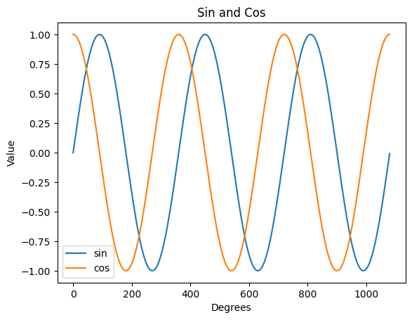

#  Reading: NumPy Library

!!! note "Start your GitHub application this week"
    This topic's homework has you create a GitHub account and apply for a free student Copilot license. GitHub takes a few days to review each application, and longer at the start of a semester, so don't leave it until the night the homework is due. The steps are in [Setting Up GitHub and Copilot](#setting-up-github-and-copilot) further down this page. Read them before class so you can ask questions while a TA is there to help.

---

# Pre-Class Reading Assignment

On the O'Reilly's website read part II: Intro to NumPy and chapters 4, 5, 6, 7, and 11 in
Python Data Science Handbook, 2nd Edition. 
</br>Here is a direct link to the readings:

<a href="https://learning.oreilly.com/library/view/python-data-science/9781098121211/part02.html" target="_blank">Part II: Introduction to NumPy</a><br>
<a href="https://learning.oreilly.com/library/view/python-data-science/9781098121211/ch04.html" target="_blank">Chapter 4: Understanding Data Types in Python</a><br>
<a href="https://learning.oreilly.com/library/view/python-data-science/9781098121211/ch05.html#ch_0202-the-basics-of-numpy-arrays_numpy-array-attributes" target="_blank">Chapter 5: The Basics of NumPy Arrays</a><br>
<a href="https://learning.oreilly.com/library/view/python-data-science/9781098121211/ch06.html#ch_0203-computation-on-arrays-ufuncs_the-slowness-of-loops" target="_blank">Chapter 6: Computation on NumPy Arrays: Universal Functions</a>
<br>Note: For chapter 6, read up to but not including the section _Specialized Ufuncs_. Skip the rest.
<br>
<a href="https://learning.oreilly.com/library/view/python-data-science/9781098121211/ch07.html" target="_blank">Chapter 7: Aggregations — min, max, and everything in between</a><br>
<a href="https://learning.oreilly.com/library/view/python-data-science/9781098121211/ch11.html" target="_blank">Chapter 11: Sorting Arrays</a><br>

The chapters we skip are about indexing and broadcasting, which we will not cover in this class. We will typically use NumPy arrays like a spreadsheet, where we just want to access the entire row or column of data. We will not be using the more advanced indexing features of NumPy.

You may want to skim through  **Chapter 9. Comparisons, Masks, and Boolean Logic**, while the topics  aren't required for this class - they are useful. 

<br>
<a href="https://learning.oreilly.com/library/view/python-data-science/9781098121211/ch09.html" target="_blank">Chapter 9: Comparisons, Masks, and Boolean Logic</a><br>


Remember that you will have to sign in to your free account that you created earlier.

## Things to look out for
- What is the difference between a list and a NumPy array?
- How to turn a list into a NumPy array?
- How to append 2 NumPy arrays together?
- The different functions you can do with a NumPy array

---
# NumPy Vectorization
Vectorization is a powerful feature of NumPy that allows you to perform operations on entire arrays without the need for explicit loops. This can lead to more concise and efficient code.

```python
import numpy as np
# Create two NumPy arrays
a = np.array([1, 2, 3])
b = np.array([4, 5, 6])
# Perform element-wise addition
c = a + b
print(c)  # Output: [5 7 9]
```
In python, you would need to loop through the arrays to add them together. With NumPy, you can add the arrays together without a loop.

It also works with other math operations like multiplication, division, and subtraction. 
```python
# Perform element-wise multiplication
d = a * b
print(d)  # Output: [ 4 10 18]
# Perform element-wise division
e = a / b
print(e)  # Output: [0.25 0.4  0.5 ]
```
# NumPy Functions

NumPy also has a lot of built-in functions that you can use to perform operations on arrays. For example, you can find the mean of an array using the `np.mean()` function or more advanced things like taking the sin or cos of the numbers in an array using `np.sin()`. 

Normally you would need a loop to do this, but with NumPy, you can do it in one line of code.

```python
# Find the mean of an array
mean_a = np.mean(a)
print(mean_a)  # Output: 2.0
# Find the sin of an array
sin_a = np.sin(a)
print(sin_a)  # Output: [0.84147098 0.90929743 0.14112001]
```
Here is a link to the NumPy website that lists all the mathematical functions you can use with NumPy arrays: [NumPy Mathematical Functions](https://numpy.org/doc/stable/reference/routines.math.html)   
</br>
Here is a link to the NumPy website that lists all the statistical functions you can use with NumPy arrays: [NumPy Statistical Functions](https://numpy.org/doc/stable/reference/routines.statistics.html)
</br>
Here is a link to the NumPy website that lists all the linear algebra functions you can use with NumPy arrays: [NumPy Linear Algebra Functions](https://numpy.org/doc/stable/reference/routines.linalg.html)
</br>

# Create NumPy Sequences
You often need a list of numbers, such as a list of numbers from 0 to 10. You can use the `np.arange()` function to create a NumPy array with a sequence of numbers. 

```python
# Create a NumPy array with a sequence of numbers from 0 to 10
sequence = np.arange(0, 10, 2)
print(sequence)  # Output: [0 2 4 6 8]
```
In the code above you give the starting value, stopping value, and step size. The function will then create an array with that many values between the starting and stopping values. If the step size doesn't fit, you may not get the last number. 

You can also use the `np.linspace()` function to create a NumPy array with a specific number of numbers between two values. 

```python
# Create a NumPy array with a sequence of numbers between 0 and 1
sequence = np.linspace(0, 1, 5)
print(sequence)  # Output: [0.   0.25 0.5  0.75 1.  ]
```
In the code above you give the starting and stopping values and the number of values you want in the array. The function will then create an array with that many values between the starting and stopping values.

Here is a link to the NumPy website that lists all the functions you can use to create NumPy arrays: [NumPy Array Creation Functions](https://numpy.org/doc/stable/reference/routines.array-creation.html).

The section on Numeric Ranges is particularly useful for creating sequences of numbers. 

# Generate random numbers
You can also use the `np.random.rand()` function to create a NumPy array with random numbers. 

```python
# Create a NumPy array with random numbers
random_numbers = np.random.rand(5)
print(random_numbers)  # Output: [0.5488135  0.71518937 0.60276338 0.54488318 0.4236548 ]
```
You can also use the `np.random.randint()` function to create a NumPy array with random integers. If you run it again, you will get different numbers. 

```python
# Create a NumPy array with random integers
random_integers = np.random.randint(0, 10, 5)
print(random_integers)  # Output: [5 0 3 3 7]
```
And there are other functions you can use to create NumPy arrays with random numbers. Here is a link to the NumPy website that lists all the functions you can use to create NumPy arrays: [NumPy Random Functions](https://numpy.org/doc/stable/reference/random/index.html)

# NumPy with Matplotlib

!!! note "A sneak peek at Matplotlib"
    NumPy is often paired with Matplotlib: NumPy builds the data and Matplotlib plots it. This example is just a sneak peek at Matplotlib, our next topic, where we will cover these plotting commands in detail.

We can use NumPy with Matplotlib to create plots. For example, we can use NumPy to create a list of numbers and then use Matplotlib to plot those numbers. We can use the numpy routines to easily create the data we want to plot. For example if we want to plot the sin, cos, and tan of a list of numbers, we can use NumPy to create the list of numbers and then use Matplotlib to plot the data. Say we want a list of number from 0 to 3*360 degrees every 0.5 degrees. We can use the `np.linspace()`  function to create the list of numbers. Then we can use the `np.sin()` and `np.cos()` functions to create the data we want to plot. Finally, we can use Matplotlib to plot the data. 
```python
import numpy as np
import matplotlib.pyplot as plt
# Create a list of numbers from 0 to 3*360 degrees with 1000 points.
x = np.linspace(0, 3*360, 1000)
# Or use arange to create a list with steps every 1/2 degree
x = np.arange(0, 3*360, 0.5)  # This will overwrite the previous x variable. Comment it out if you want to use the linspace version.

# Create the data we want to plot
y1 = np.sin(np.radians(x))
y2 = np.cos(np.radians(x))

# Plot the data
plt.plot(x, y1, label='sin')
plt.plot(x, y2, label='cos')

plt.xlabel('Degrees')
plt.ylabel('Value')
plt.title('Sin and Cos')
plt.legend()
plt.show()
```


In the code above we use the `np.radians()` function to convert the degrees to radians. This is because the `np.sin()` and `np.cos()` functions expect the input to be in radians. We then use Matplotlib to plot the data.

Here is a link to the Matplotlib website that lists all the functions you can use to create plots: [Matplotlib Pyplot](https://matplotlib.org/stable/api/pyplot_api.html)
</br>

---

<!-- Keep in sync with Part 5 of numpy_hw.md, which repeats these steps. -->

# Setting Up GitHub and Copilot

Later in Unit 3 you will use an AI coding agent called GitHub Copilot, which is free for verified students. Setting this up is part of the Numpy homework, but read through it now so you can ask questions in class or of a TA before you do it.

GitHub reviews each application, which usually takes a few days and can take longer at the start of a semester, so start as soon as you can. Follow the steps in order, because an application can be rejected if Steps 1 to 3 are incomplete.

**Step 1: Create a GitHub account**

1. Go to [github.com](https://github.com/) and click **Sign up**. Use your **@byu.edu** email address.
2. Choose your username with care. It appears in the address of every web page you publish from GitHub, and many engineers use their GitHub profile as part of their résumé.
3. Open the email from GitHub and verify your address.

If you already have a GitHub account, keep it. Add your @byu.edu address under **Settings → Emails** and verify it.

!!! warning "Four things to check before you apply"
    GitHub's own application page does not mention these, but we have tested it: applications without them are rejected, and applications with them are accepted. Before you click **Start an application**, make sure all four are true:

    1. Your **@byu.edu email** is on your account and verified (Step 1).
    2. **Two-factor authentication** is turned on (Step 2).
    3. Your **name** on GitHub matches the name BYU has for you (Step 3).
    4. Your **billing information** is filled in — name and address, no credit card (Step 3).

**Step 2: Turn on two-factor authentication**

1. Install an authenticator app on your phone, such as Google Authenticator or Microsoft Authenticator.
2. On GitHub, click your profile picture, then go to **Settings → Password and authentication**.
3. Click **Enable two-factor authentication**.
4. Scan the QR code with the app, and enter the six-digit code it shows.
5. Click **Download** to save your recovery codes, and keep the file somewhere safe. If you lose your phone, these codes are how you get back into your account.
6. Click **I have saved my recovery codes**.

**Step 3: Add your name and billing information**

Your name on GitHub has to match the name BYU has on record for you — the same name that appears on your BYU ID and on whatever document you upload in Step 4. This is the step that catches people out:

- Use your full legal name, not a nickname. If BYU has you as "David," don't put "Dave."
- Include your middle name or initial if it appears on your ID.
- Look at your BYU ID while you type it rather than going from memory.

1. Go to **Settings → Public profile**, enter your name in the **Name** box, and click **Update profile**.
2. Go to **Settings → Billing & Licensing → Payment information**.
3. Add your first name, last name, and address.

!!! danger "Do not enter a credit card"
    GitHub asks for billing information, but everything you are applying for is free. Enter your first name, last name, and address only. Leave the payment method empty — you do not need a credit card, and you should not add one.

**Step 4: Apply for student benefits**

Before you start, have your BYU ID with you and turn off any VPN. Apply from campus if you can, because GitHub checks your location.

1. Go to [github.com/settings/education/benefits](https://github.com/settings/education/benefits) and click **Start an application**.
2. Select your @byu.edu email and **Brigham Young University**.
3. Allow your browser to share your location and use your camera when it asks.
4. When asked for proof, upload a picture of your BYU ID. Your full name, Brigham Young University, and the expiration date must all be easy to read, because GitHub needs to see a date. A class schedule, transcript, or enrollment verification letter also works.
5. Click **Submit application**.
6. Take a screenshot showing that your application was submitted. You will turn this in with the Numpy homework.

**Step 5: Turn on Copilot after you are approved**

Approval alone doesn't turn Copilot on. GitHub will email you when you are approved, and the benefit can take several more days to finish applying to your account. Then:

1. Go to [github.com/settings/education/benefits](https://github.com/settings/education/benefits).
2. Under **Free GitHub developer resources for students and teachers**, click **Learn more**.
3. Follow the prompts to activate **Copilot Student**.

If your account still shows the free plan after a few days, try [github.com/settings/copilot](https://github.com/settings/copilot) and follow the prompts. **If you are only offered paid plans, do not buy anything.** Wait a few days and try again, and contact GitHub Support if it still doesn't work.

If your application is rejected, read the reason in the email, fix it, and apply again. The most common problems are a name that doesn't match the name BYU has for you, missing billing information, two-factor authentication turned off, an unverified BYU email, location sharing turned off, a VPN, or a blurry photo. If you are still waiting when we start using Copilot, you can use Copilot's free plan, which is limited to 2,000 code completions per month.

---

# Pre-Class Quiz Challenge
The challenge has two parts, and both are done in the same notebook:

- **Part 1 - Quiz Questions:** Answer the questions below in the **Quiz Answers** text block at the top of the notebook. Double-click the text block to edit it, and type your answer after each **Answer:**.
- **Part 2 - Code Blocks:** Complete Code Blocks 1-3 by following the instructions in the notebook.

<a href="https://colab.research.google.com/github/byu-cce270/content/blob/main/docs/unit3/00_numpy/Pre_Numpy.ipynb" target="_blank"></a>

Save your changes, then download the completed notebook with **File | Download | Download .ipynb** and upload it to Learning Suite.

## Part 1 - Quiz Questions
Each question lists where in the reading to find the answer. Chapter numbers refer to *Python Data Science Handbook, 2nd Edition*. Section names are the headings inside each chapter.

**Question 1.** Did you do the reading?

- T) Yes, I did
- F) No

**Question 2.** What is the first thing you should always do if you intend to use NumPy in your code?

- A) `import np as numpy`
- B) `import numpy as np`
- C) `upload numpy as np`
- D) `import np`

*Where to look: Part II: Introduction to NumPy (the last paragraphs, where NumPy is imported).*

**Question 3.** What is the output of the following code?

```python
import numpy as np
ary = np.array([1, 2, 3, 5, 8])
ary = ary + 1
print(ary[1])
```

- A) 0
- B) 1
- C) 2
- D) 3

*Where to look: Chapter 6, section "Exploring NumPy's Ufuncs" - "Array Arithmetic", and Chapter 5, section "Array Indexing: Accessing Single Elements". The NumPy Vectorization section of this page also covers this.*

**Question 4.** What will be the output of the following code?

```python
import numpy as np
nums = [2,3,4,5]
updatednums = np.array(nums)
print(updatednums)
```

- A) `['2' '3' '4' '5']`
- B) `[2,3,4,5]`
- C) `[2 3 4 5]`
- D) `[5 4 3 2]`

*Where to look: Chapter 4, section "Creating Arrays from Python Lists".*

**Question 5.** What is the syntax for changing a list called `mylist` into an array using NumPy?

- A) `array(mylist)`
- B) `mylist.np_array()`
- C) `np.array(mylist)`
- D) `array(mylist).np`

*Where to look: Chapter 4, section "Creating Arrays from Python Lists".*

**Question 6.** True or False: given the array below, the syntax `my_array[1]` returns `[1 2 3]`.

```python
my_array = np.array([[1, 2, 3], [4, 5, 6], [7, 8, 9]])
```

- T) True
- F) False

*Where to look: Chapter 5, section "Array Slicing: Accessing Subarrays" - "Accessing array rows and columns".*

**Question 7.** What is the output of the following code?

```python
import numpy as np
a = np.arange(10)
print(a[2:5])
```

- A) `[2 3 4]`
- B) `[0 1 2]`
- C) `[5 6 7]`
- D) `[2 4 6]`

*Where to look: Chapter 4, section "Creating Arrays from Scratch" (for `np.arange`), and Chapter 5, section "Array Slicing: Accessing Subarrays" - "One-Dimensional Subarrays".*

**Question 8.** What syntax would you use to solve the system of linear equations containing arrays `A` and `B`?

- A) `np.linalg.solve(A, B)`
- B) `linalg.solve.np(A, B)`
- C) `np.solve(A, B)`
- D) `linalg.solve(A, B)`

*Where to look: This is not in the textbook. See the NumPy Functions section of this page and its NumPy Linear Algebra Functions link.*

## Part 2 - Code Blocks
Complete Code Blocks 1-3 in the notebook. The instructions are in the text block above each code block.

---

## Turning in/Rubric

**_REMINDER_** - For this class, **you will download your completed Colab notebook and upload the `.ipynb` file to Learning Suite**. Make sure the notebook you upload is for the correct assignment and contains your finished work.

**Rubric:**

|                             Item                             | Points Possible |
|:------------------------------------------------------------:|:---------------:|
|        Part 1 - Question 1 (Did you do the reading?)        |        2        |
| Part 1 - Questions 2-8 (10 points split evenly, correct answers) |       10        |
|            Part 2 - Code Blocks 1-3 (1 point each)            |        3        |
|        <div style="text-align: right">**Total**</div>         |       15        |

---

The following is not a part of the rubric, but specifies how you can lose points. For example: if you fail to upload your file correctly.

| **Reasons for Points Lost** |    **Amount**     |  
|:---------------------------:|:-----------------:|
|  File uploaded incorrectly  |       -10%        | 