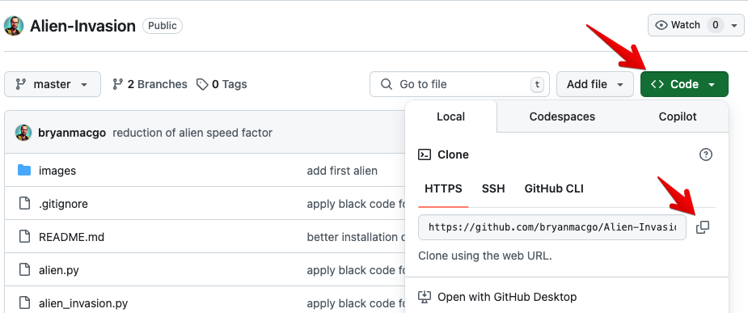
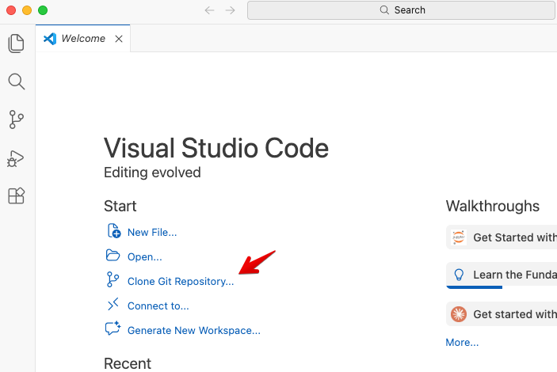
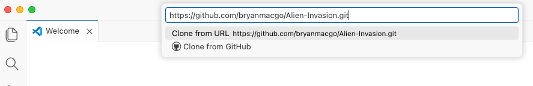
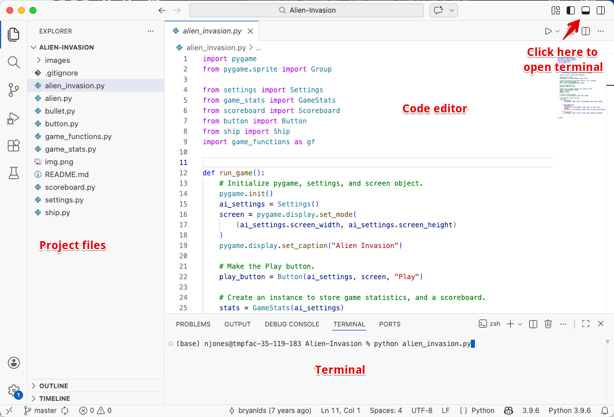
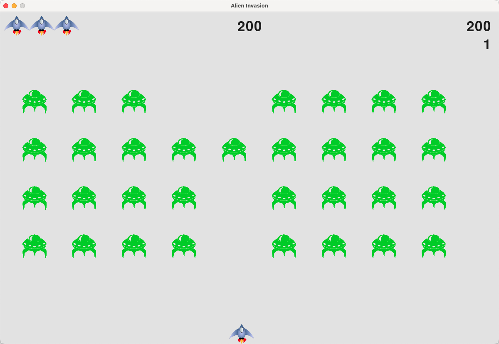

# In-Class Exercise: Running Python Locally

Before class, you should have installed Python, VS Code, and Git and applied for the GitHub Student Developer Pack, as described in the [reading](local_py_read.md). If any of that didn't work, get a TA's help before starting Exercise 2.

## Exercise 1 - Find Your Way Around the Terminal

1. In VS Code, choose **File → Open Folder** and open your class folder (for example, `Documents/cce270`). If you don't have one yet, make it first.
2. Open the terminal with **Terminal → New Terminal**.

    !!! warning "Screenshot needed"
        VS Code with a class folder open and the terminal panel at the bottom.

3. Check where you are with `pwd` (Mac) or `cd` (Windows). It should be your class folder.
4. Make a folder for today and move into it:

    ```
    mkdir local_python
    cd local_python
    ```

5. Create a file named `beam.py` in that folder and paste in this code, which computes the maximum moment and deflection of a simply supported beam with a uniform load:

    ```python
    # Simply supported beam with a uniform load
    w = float(input("Uniform load w (kip/ft): "))
    L = float(input("Span L (ft): "))
    E = 29000      # ksi, steel
    I = 510        # in^4, W18x35

    M_max = w * L**2 / 8                                  # kip-ft
    delta = 5 * (w / 12) * (L * 12)**4 / (384 * E * I)    # in

    print(f"Maximum moment: {M_max:.1f} kip-ft")
    print(f"Maximum deflection: {delta:.2f} in")
    print(f"L/360 limit: {L * 12 / 360:.2f} in")
    ```

6. Run it from the terminal with `python beam.py` (or `python3 beam.py` on a Mac). Try a 1.0 kip/ft load on a 25 ft span, then 1.5 kip/ft on a 30 ft span. Check the first answer by hand: $M = wL^2/8 = 78.1$ kip-ft.
7. Run `ls` (Mac) or `dir` (Windows) to see your file, then `cd ..` to move back up to your class folder.

## Exercise 2 - Clone and Run a Game

Python Crash Course, the textbook we've used this semester, builds a game called "Alien Invasion" in Chapters 12–14. Someone has posted a complete version on GitHub, and you will download it with Git, run it, and change it.

### Clone the Repository

1. Browse to the repo: [https://github.com/bryanmacgo/Alien-Invasion](https://github.com/bryanmacgo/Alien-Invasion)

2. Click the green **Code** button and copy the URL.

    

3. In VS Code, choose **File → New Window**. On the Welcome tab, click **Clone Git Repository**.

    

4. Paste the URL:

    

5. Choose your class folder as the location. VS Code will clone the repo and offer to open it. Click **Open**.

### Install pygame and Run the Game

Open the terminal (**Terminal → New Terminal**) and install pygame:

```bash
pip install pygame-ce
```

`pygame-ce` is the community edition of pygame. It uses the same `import pygame` statement, and unlike the original package it supports the newest versions of Python.

The project files appear in the Explorer panel on the left. `alien_invasion.py` starts the game, and the other files hold the ship, the aliens, the scoreboard, and the settings.



Run the game:

```bash
python alien_invasion.py
```

{width=800}

Use the arrow keys to move, the space bar to fire, and **Q** to quit.

### Change the Game

Open `settings.py`. Every number that controls how the game plays is defined here. Make these changes, saving and rerunning the game after each one:

- Set `bullet_width` to `300` so your bullets clear a whole section of aliens at once
- Change `bullets_allowed` from `3` to `10`
- Change `bullet_color` to something bright, such as `255, 0, 0`
- Speed up the aliens by changing `alien_speed_factor`

Now open the **Source Control** panel (the branching icon on the left sidebar, or **Ctrl+Shift+G** / **Cmd+Shift+G**). It lists `settings.py` as changed. Click the file name to see a side-by-side comparison: red lines are what you removed and green lines are what you added. This view will matter a great deal once an AI agent is making the changes.

!!! warning "Screenshot needed"
    Source Control panel listing `settings.py`, with the side-by-side diff of the `bullet_width` change open.


## Exercise 3 - Your First GitHub Repository

Now you will put your own code on GitHub.

1. In VS Code, open your `local_python` folder from Exercise 1 (**File → Open Folder**).
2. Open the **Source Control** panel and click **Initialize Repository**. Git now tracks this folder.
3. Your `beam.py` file is listed under **Changes**. Type a message in the box at the top, such as `Add beam calculator`, and click **Commit**. If VS Code asks whether to stage all your changes, click **Yes**.
4. Click **Publish Branch**. Choose **public repository** and accept the suggested name. If VS Code asks you to sign in to GitHub, do so.

    !!! warning "Screenshot needed"
        Source Control panel after the first commit, showing the **Publish Branch** button, and the public/private repository prompt.

5. Click the link VS Code shows (or go to your GitHub profile) and find your repository. Your code is now on GitHub.

Now make a second commit:

1. Change `beam.py` to also print whether the beam passes the L/360 deflection check. For example:

    ```python
    if delta <= L * 12 / 360:
        print("Deflection OK")
    else:
        print("Deflection too large - choose a stiffer beam")
    ```

2. Run it to make sure it works.
3. Commit with the message `Add deflection check`.
4. Click **Sync Changes** to push the commit to GitHub.
5. Refresh your repository page on GitHub and click the commit count (the clock icon) to see both commits.

That is the whole Git workflow you will use for the rest of the semester: **change, test, commit, push**.

## Exercise 4 - Meet Your Coding Agent

If your Copilot student license hasn't been approved yet, use the free plan for this exercise.

1. Open the Alien Invasion folder from Exercise 2. In the Source Control panel, discard your changes to `settings.py` (right-click the file and choose **Discard Changes**) so the game is back to its original state.
2. Open the Copilot chat panel (the chat icon at the top of VS Code) and make sure the mode is set to **Ask**.

    !!! warning "Screenshot needed"
        The Copilot chat panel with the mode picker open, showing the **Agent**, **Ask**, and **Plan** options.

    Ask it:

    !!! prompt "Prompt"
        Explain how this game is organized. Which file handles keyboard input, and how does the main loop work?

    Compare its answer to what you see in the files.

3. Switch the mode to **Agent** and ask:

    !!! prompt "Prompt"
        Add a pause feature. Pressing P should pause the game and show the word "PAUSED" in the middle of the screen. Pressing P again should resume.

4. When the agent finishes, go to the **Source Control** panel and look at what it changed. Which files did it edit? Can you find the new code that checks for the P key?
5. Run the game and test the feature. Does it work? Does anything else break?
6. If it works, commit it. If it doesn't, describe the problem to the agent and let it try again. If it makes things worse, discard all the changes in the Source Control panel and start over.

Steps 4–6 are the habit to build: **ask the agent, review what it changed, test it, then commit or throw it away.**
