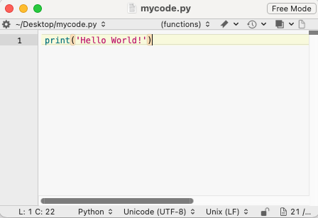
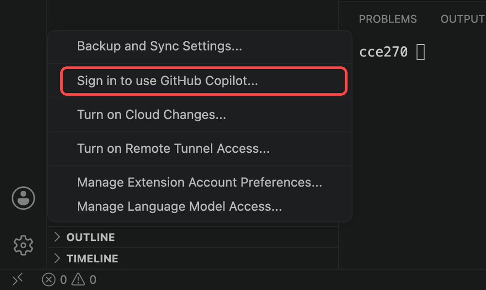

# Reading: Using Python Locally

---

So far in this class, you have written all of your Python in Google Colab, which runs Python in the cloud and comes with most packages already installed. For the rest of the semester, you will work on your own computer. In the next two sections, you will use AI coding agents to build a web application and a desktop application, and you will do your final project the same way. Those tools run on your own machine, so this section gets you set up:

- Python, VS Code, and Git installed on your laptop
- Enough of the command line to move around and run a program
- A GitHub account, which you will use to store your code and publish your web apps
- GitHub Copilot, the AI coding agent you will use for the rest of the semester

You should have created your GitHub account and applied for the free Copilot student license in the Numpy homework. If you haven't, do it now using the steps in [Your GitHub Account and Copilot](#your-github-account-and-copilot) below, because approval can take up to two weeks.

## Basic Concepts

**Running Python locally**

In Colab, Python is already installed and you run code one cell at a time. On your own computer, you install Python yourself, write your code in a file that ends in `.py`, and run the whole file at once from a terminal:



```bash
python mycode.py
```

```bash
Hello World!
```

**Installing packages**

Colab comes with numpy, pandas, matplotlib, and most other packages you have used. Locally, you install each package yourself with **pip**, Python's package manager:

```bash
pip install numpy pandas matplotlib
```

You only need to install a package once per computer.

**Using an IDE**

You could write Python in any text editor, but an Integrated Development Environment (IDE) makes it much easier. An IDE has a file browser, a code editor with syntax highlighting and error checking, a built-in terminal, and AI tools. We will use [Visual Studio Code (VS Code)](https://code.visualstudio.com/), which is free and is the most widely used IDE for Python. VS Code can also open `.ipynb` notebooks, so you can still run your Colab notebooks locally.

**Git and GitHub**

**Git** is a program that keeps a history of the changes in a project folder. Each time you reach a good stopping point, you make a **commit**, which is a saved snapshot of every file in the folder along with a short message describing what changed. If you break something later, you can see exactly what changed and go back to any earlier commit. A project folder tracked by Git is called a **repository** (or **repo**).

**GitHub** is a website that stores copies of Git repositories online. You **push** your commits from your laptop to GitHub to back them up and share them, and you **clone** someone else's repository to download a copy. GitHub can also host a web page straight from a repository, which you will use in the next section to put your web app online.

Git matters even more when you work with an AI agent. An agent can change a dozen files in a few seconds. Git shows you exactly what it changed, and if the change broke something, you can throw it away and go back to your last commit.

## Setup Guide

Follow the section for your operating system. If you get stuck, bring your laptop to class or to TA office hours.

---

### 🪟 Windows

#### 1. Install Python

1. Go to [python.org/downloads](https://www.python.org/downloads/)
2. Click **Download Python 3.x.x** (the big yellow button). **If the yellow button says "Download Python Install Manager", click the hyperlink below it that says "get the standalone installer for Python 3.x.x"**
3. Run the installer
4. ⚠️ **Important:** Check the box that says **"Add Python to PATH"** before clicking Install
5. Click **Install Now**
6. Verify it worked. Open **Command Prompt** (search "cmd" in the Start menu) and type:

```
python --version
```

You should see something like **Python 3.15.1**

#### 2. Install VS Code

1. Go to [code.visualstudio.com](https://code.visualstudio.com/)
2. Click **Download for Windows**
3. Run the installer. The defaults are fine.
4. When prompted, check the **"Add to PATH"** and **"Open with Code"** options
5. Open VS Code and install the **Python extension**:

   - Click the Extensions icon on the left sidebar (or press **Ctrl+Shift+X**)
   - Search for **Python** (by Microsoft)
   - Click **Install**

#### 3. Install Git

1. Go to [git-scm.com/download/win](https://git-scm.com/download/win)
2. Download and run the installer
3. All default options are fine. Keep clicking **Next**.
4. Verify it worked. Open a new Command Prompt and type:

```
git --version
```

#### 4. Install Packages with pip

In Command Prompt, install the packages we have used this semester:

```
pip install numpy pandas matplotlib
```

---

### 🍎 Mac

#### 1. Install Python

1. Go to [python.org/downloads](https://www.python.org/downloads/)
2. Click **Download Python 3.x.x** (the big yellow button)
3. Open the downloaded **.pkg** file and follow the installer steps
4. Verify it worked. Open **Terminal** (press **Cmd+Space** and search "Terminal") and type:

```
python3 --version
```

You should see something like **Python 3.15.1**

**Note:** On a Mac, the commands are usually `python3` and `pip3` rather than `python` and `pip`. Wherever this class says `python` or `pip`, use `python3` or `pip3` if the shorter version gives an error.

**Note:** Your Mac may prompt you to install **Xcode Command Line Tools** the first time you run `python3` or `git`. Click **Install** and wait for it to finish. You can also install them yourself with:

```
xcode-select --install
```

#### 2. Install VS Code

1. Go to [code.visualstudio.com](https://code.visualstudio.com/)
2. Click **Download for Mac**
3. Open the downloaded **.zip**, then drag **Visual Studio Code** to your **Applications** folder
4. Open VS Code, then install the **Python extension**:

   - Click the Extensions icon on the left sidebar (or press **Cmd+Shift+X**)
   - Search for **Python** (by Microsoft)
   - Click **Install**

#### 3. Install Git

Git may already be installed on your Mac. Check by typing this in Terminal:

```
git --version
```

If it is not installed, you will be prompted to install **Xcode Command Line Tools**. Click **Install** and Git comes with them.

#### 4. Install Packages with pip

In Terminal, install the packages we have used this semester:

```
pip3 install numpy pandas matplotlib
```

**Note:** If you get `pip3: command not found`, Python is not on your PATH. Run this in Terminal, replacing `3.15` with your installed Python version:

```
echo 'export PATH="/Library/Frameworks/Python.framework/Versions/3.15/bin:$PATH"' >> ~/.zshrc
source ~/.zshrc
```

Then try `pip3 install numpy pandas matplotlib` again.

---

## The Command Line

The **terminal** (called **Command Prompt** or **PowerShell** on Windows) lets you control your computer by typing commands. You will use it to run Python programs, install packages, and run AI coding agents. VS Code has a terminal built in: choose **Terminal → New Terminal** and it opens at the bottom of the window, already inside your project folder.

At any moment, the terminal is "in" one folder, called the **working directory**. Commands act on that folder unless you tell them otherwise. These are the commands you will use most:

| What it does                           | Mac                  | Windows              |
|:---------------------------------------|:---------------------|:---------------------|
| Show which folder you are in           | `pwd`                | `cd`                 |
| List the files in this folder          | `ls`                 | `dir`                |
| Move into a folder                     | `cd foldername`      | `cd foldername`      |
| Move up one folder                     | `cd ..`              | `cd ..`              |
| Make a new folder                      | `mkdir foldername`   | `mkdir foldername`   |
| Run a Python program                   | `python3 myfile.py`  | `python myfile.py`   |
| Install a package                      | `pip3 install name`  | `pip install name`   |
| Stop a program that is running         | **Ctrl+C**           | **Ctrl+C**           |

Two habits will save you a lot of trouble:

- **Press Tab to finish a file or folder name.** Type `cd Doc` and press Tab, and the terminal fills in `Documents`. This also avoids typos.
- **Read the error message.** If Python says `No such file or directory`, you are usually in the wrong folder. Run `pwd` (or `cd` on Windows) to check where you are.

### Running Your First Script in VS Code

1. Make a folder for this class somewhere easy to find, such as `Documents/cce270`
2. In VS Code, choose **File → Open Folder** and open that folder
3. Choose **File → New File** and name it **hello.py**
4. Type:

    ```python
    name = input("What is your name? ")
    print(f"Hello, {name}!")
    ```

5. Open the terminal (**Terminal → New Terminal**) and run:

    ```
    python hello.py
    ```

You can also click the **▷ Run** button in the top-right corner of the editor, which runs the same command for you.

## Your GitHub Account and Copilot

### 1. Create a GitHub account and apply for Copilot

You did this in [Part 5 of the Numpy homework](../00_numpy/numpy_hw.md#part-5-set-up-github-and-apply-for-copilot). If you haven't finished it, follow those steps now: create your account with your @byu.edu email, turn on two-factor authentication, add your name and billing information, apply for student benefits, and activate **Copilot Student** after you are approved.

If you are still waiting for approval when we start using Copilot, you can use Copilot's free plan, which has a monthly usage limit.

### 2. Tell Git who you are

Git attaches a name and email to every commit you make. Set them once on each computer by running these commands in the terminal, using your own name and the email from your GitHub account:

```
git config --global user.name "Your Name"
git config --global user.email "you@byu.edu"
git config --global init.defaultBranch main
```

The third command makes new repositories start on a branch named `main`, which is the name GitHub uses. Without it, some computers name the first branch `master`.

### 3. Sign in to GitHub from VS Code

Click the **Accounts** icon (the person at the bottom of the left sidebar) and choose **Sign in to use GitHub Copilot**. This lets VS Code push your code to GitHub and turns on Copilot.

{:width="500px"}

## Agentic Coding

Colab's AI features suggest a line or a block of code at a time. An **AI coding agent** works on a whole project. You describe what you want in plain English, and the agent reads your files, writes and edits code across several files, runs your program, reads the errors, and fixes them. Your job shifts from typing every line to describing the problem clearly, reviewing what the agent wrote, and testing whether the result is right.

These are the three agents we support in this class:

**[GitHub Copilot](https://github.com/features/copilot)** is built into VS Code. Open the chat panel (the chat icon in the title bar, or **Ctrl+Alt+I** on Windows and **Ctrl+Cmd+I** on a Mac), choose a mode from the picker at the bottom of the panel, and describe what you want. **Interactive** works with you step by step and makes changes to your files. **Plan** researches your request and writes a plan without changing your files. **Autopilot** works on its own until the task is done, approving its own file edits and terminal commands and answering its own questions, so you review the results at the end. If your picker shows **Agent** and **Ask** instead, use **Agent** wherever these pages say **Interactive**, and **Ask** wherever they say **Plan**. Copilot is free with the Student Developer Pack, and **it is all you need for this class.**

**[Claude Code](https://claude.com/product/claude-code)** from Anthropic and **[Codex](https://openai.com/codex/)** from OpenAI are agents that you can run in the VS Code terminal or in their own VS Code extensions. Claude Code requires a paid plan of about \$20 per month. Codex has a limited free tier, and its full plan is also about \$20 per month. They are optional, but they are generally more capable than Copilot on larger projects. If you plan to use AI for programming after this class, one month of either is worth considering for the final project.

Whichever agent you use, the results depend on how well you understand the problem. If you can describe the inputs, the steps, and the expected output clearly, an agent can build a surprising amount. If you can't, it will confidently build the wrong thing. That is why the first half of this course taught you to program by hand: you need to be able to read what the agent writes and tell whether it is correct.

---

# Pre-Class Quiz Challenge

Before class, do the following:

1. Install Python, VS Code, and Git using the [Setup Guide](#setup-guide)
2. Check the status of your Student Developer Pack application at [github.com/settings/education/benefits](https://github.com/settings/education/benefits). If you never applied, follow [Part 5 of the Numpy homework](../00_numpy/numpy_hw.md#part-5-set-up-github-and-apply-for-copilot) now.
3. In the VS Code terminal, run `python --version` and `git --version` (use `python3` on a Mac)

Take **two screenshots**: one of the VS Code terminal showing the output of both commands, and one showing your Student Developer Pack status (approved or pending). Upload both with your Pre-Class Quiz.

If something won't install, upload a screenshot of the error instead and come to class early. TAs will be available to help.

---

## Turning in/Rubric

**Rubric:**

|                      Item                      | Points Possible |
|:----------------------------------------------:|:---------------:|
| <div style="text-align: right">**Total**</div> |        3        |

---

The following is not a part of the rubric, but specifies how you can lose points. For example: if you fail to upload your file correctly.

| **Reasons for Points Lost** |    **Amount**     |  
|:---------------------------:|:-----------------:|
|  File uploaded incorrectly  |       -10%        | 
