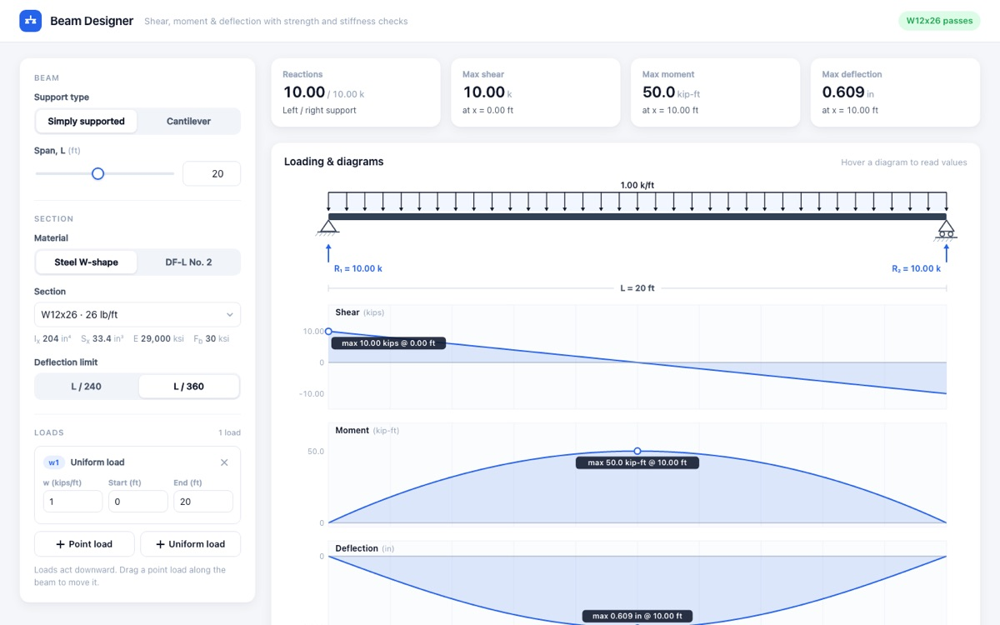
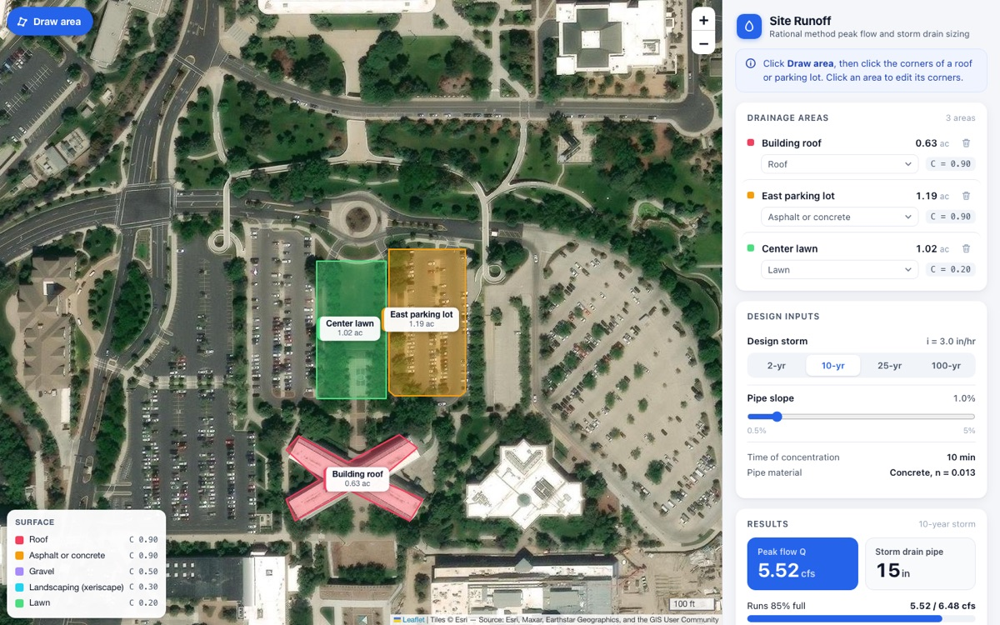

# In-Class Exercise: Your First Agent-Built App

In this exercise, you will have an agent build a professional engineering web app from a spec, check that its answers are right, make it your own with new features, and publish it on GitHub Pages. Your instructor will pick one of the three apps below for the class to build:

- **[Beam Designer](#beam-designer):** shear, moment, and deflection diagrams with strength and stiffness checks for steel and lumber beams
- **[Site Runoff](#site-runoff):** outline the roofs, pavement, and lawns of a site on satellite imagery, then compute the storm runoff and size the drain pipe
- **[Concrete Pour Planner](#concrete-pour-planner):** outline a slab on satellite imagery, then compute the concrete to order, the number of trucks, and an arrival schedule for the batch plant

Each app was built by an agent from the spec on this page, with no other instructions. The screenshots show what that first build looked like. Yours will look different, because agents don't give the same answer twice, and that is fine as long as it passes validation.

## Step 1 - Set Up the Project

1. Make a folder named `first_app` in your class folder and open it in VS Code.
2. In the **Source Control** panel, click **Initialize Repository**.
3. Create a file named `AGENTS.md` containing this line, so the agent keeps your prompt log (see the [reading](web_read.md#standing-instructions-and-the-prompt-log)):

    ```markdown
    - After each request, add an entry to prompts.md: what I asked, what you changed, and whether it worked.
    ```

In Using Python Locally you made commits yourself. From here on, the agent makes them. Whenever this page says to ask the agent to commit, enter "Commit these changes" in **Agent** mode, allow the `git` command it asks to run, and read the commit message it writes.

## Step 2 - Write the Spec

Create a file named `spec.md` and paste in the spec for your app from the sections below. Read it all the way through before you go on. Every sentence in it is a decision someone had to make.

Notice the **Look and feel** section. It is the reason these apps look professional on the first try. An agent will build exactly as plain an app as you ask for, so describe the app you want: who it looks like, how it is laid out, and what the user sees when it first opens.

Ask the agent to commit.

## Step 3 - Review the Spec

Even a spec someone else wrote can be improved. In the Copilot chat panel, switch to **Ask** mode and enter:

!!! prompt "Prompt"
    Read spec.md. Don't write any code. List anything in this spec that is ambiguous, missing, or inconsistent, check the equations in the Calculations section, and point out anything that will be hard to build. Suggest improvements.

Discuss the suggestions with the people around you. Take any that make the spec clearer, and skip any that add features you don't need yet. Update `spec.md` and ask the agent to commit.

## Step 4 - Build It

Switch to **Agent** mode and enter:

!!! prompt "Prompt"
    Read spec.md and build the app it describes as a single file named index.html. Use plain HTML, CSS, and JavaScript with no build tools. You may load libraries from a CDN. Put the calculations in their own clearly named functions, separate from the drawing code.

Watch what the agent does. It will probably write the file in pieces, and it may ask permission to run commands. When it finishes, double-click `index.html` to open it in your browser.

Try every input. If something doesn't work, describe exactly what you did and what happened, and ask the agent to fix it. Check the browser's developer console for red error messages (**Ctrl+Shift+J** on Windows, or **Cmd+Option+J** in Chrome on a Mac) and paste any you find into the chat.

When the app works, ask the agent to commit.

## Step 5 - Validate

Work the hand checks listed for your app below, with a calculator and without looking at the app. Then enter each validation case from the spec into the app and compare. A few cases, such as an outline given by latitude and longitude, can't be typed into the app. Ask the agent to run those through the app's calculation functions and show you the result.

If anything doesn't match, look at the units, the sign convention, and your own arithmetic before asking the agent. Then give the agent the inputs, the expected values, how you got them, and what the app showed. Sometimes the app will be right and you will be wrong. When this exercise was tested, one of the expected values in the Beam Designer spec was wrong, and the app caught it.

When every case matches, ask the agent to commit.

## Step 6 - Make It Yours

Add **two features**, one at a time. Your app's section lists a few ideas, but your own ideas are better. For each feature:

1. Add it to the spec (Inputs, Calculations, and Outputs, as needed), and add a validation case if it computes something new.
2. Ask the agent to build it.
3. Try it, and rerun your validation cases to make sure nothing that used to work is broken.
4. Ask the agent to commit.

## Step 7 - Publish

1. In the Source Control panel, click **Publish Branch** and choose a **public** repository.
2. On your repository's page on GitHub, go to **Settings → Pages**. Set **Source** to **Deploy from a branch**, choose your branch (**main**, or **master** on some computers) and **/ (root)**, and click **Save**.
3. After a few minutes, refresh the page to see your site's address. Open it on your phone.
4. Send the link to someone sitting near you and try each other's features.

---

## Beam Designer

{:width="700px"}

```markdown
# Beam Designer

## Purpose
A beam design tool for engineers and students. The user sets up a beam,
places loads on it, and picks a steel or lumber section. The app shows the
shear, moment, and deflection diagrams and checks whether the beam is
strong and stiff enough, updating instantly as anything changes.

## Users
A civil engineering student checking a homework beam, or an engineer
sizing a floor beam or deck joist.

## Inputs
- Support type: Simply supported or Cantilever (fixed at the left end).
- Span: 4 to 40 ft, set with a slider and a number box that stay in sync.
- Loads, listed in a panel where each can be edited or removed:
  - Point loads: magnitude (kips, downward positive) and position (ft).
    A new point load starts at midspan (at the free end of a cantilever).
  - Uniform loads: magnitude (kips/ft) and start and end positions (ft).
  - "Add point load" and "Add uniform load" buttons.
  - Point loads can also be dragged along the beam in the drawing,
    snapping to 0.25 ft.
  - Loads that extend past the end of the beam are cut off at the end.
- Material and section, from these tables:

  Steel W-shapes (E = 29,000 ksi, allowable bending stress Fb = 30 ksi):

  | Section | Ix (in^4) | Sx (in^3) | Weight (lb/ft) |
  |---------|-----------|-----------|----------------|
  | W8x10   | 30.8      | 7.81      | 10 |
  | W10x12  | 53.8      | 10.9      | 12 |
  | W12x26  | 204       | 33.4      | 26 |
  | W14x22  | 199       | 29.0      | 22 |
  | W16x26  | 301       | 38.4      | 26 |
  | W18x35  | 510       | 57.6      | 35 |
  | W21x44  | 843       | 81.6      | 44 |
  | W24x55  | 1350      | 114       | 55 |

  Douglas Fir-Larch No. 2 lumber (E = 1,600 ksi, Fb = 0.900 ksi):

  | Section | Ix (in^4) | Sx (in^3) |
  |---------|-----------|-----------|
  | 2x8     | 47.63     | 13.14     |
  | 2x10    | 98.93     | 21.39     |
  | 2x12    | 177.98    | 31.64     |

- Deflection limit: L/240 or L/360 (default L/360).
- Self-weight is ignored.

## Calculations
- Reactions from statics.
- Shear V(x) and moment M(x) along the beam, at 1 ft spacing or finer,
  plus exactly at every load point and load start/end.
- Deflection y(x) by integrating M/EI twice with the boundary conditions
  for the support type (y = 0 at both supports; or y = 0 and slope = 0 at
  the fixed end).
- Bending stress fb = |M max| x 12 / Sx (ksi). Bending check passes if
  fb <= Fb.
- Deflection check passes if |y max| <= L/240 or L/360 (L in inches).
- Lightest passing section: of the sections in the chosen material, the
  lightest steel section that passes both checks (if two weigh the same,
  the one with the larger Ix), or the first lumber size in the table
  that passes.
- Units: kips, ft, and kip-ft on screen; inches for deflection.

## Outputs
- A beam drawing with the supports, load arrows (point loads as single
  arrows, uniform loads as a row of small arrows), and the reactions.
- Three diagrams stacked under the beam and lined up with it on the same
  x scale: shear (kips), moment (kip-ft), and deflected shape (in). Each
  diagram is filled and shows its maximum value labeled at its location.
- Moving the mouse over any diagram shows a vertical line across all three
  with the values of V, M, and y at that x.
- Two check cards: Bending and Deflection. Each shows the actual value, the
  allowable value, a bar for the ratio (green under 70%, amber 70-100%,
  red over 100%), and PASS or FAIL.
- A line suggesting the lightest passing section, with a button to use it.
- Everything updates immediately whenever any input changes.

## Look and feel
- Opens with an example already loaded (20 ft simply supported W12x26
  with a 1 kip/ft uniform load over the full span), so it is useful the
  moment it opens.
- Clean and professional, like a commercial engineering web app: light
  background, white cards with soft shadows, one accent color, a modern
  system font, generous spacing. No clutter.
- Inputs in a panel on the left; drawing, diagrams, and checks on the
  right. On a phone, the panels stack.
- Every input has a short label with units. Hovering over a check card
  explains the formula used.

## Validation
1. Simply supported, 20 ft, W12x26, uniform 1 kip/ft over the full span:
   reactions 10 k and 10 k; max shear 10 k; max moment 50.0 kip-ft at
   10 ft; fb = 17.96 ksi; max deflection 0.609 in at 10 ft; L/360 =
   0.667 in; both checks pass.
2. Simply supported, 20 ft, W12x26, point load 10 k at 5 ft: reactions
   7.5 k (left) and 2.5 k (right); max moment 37.5 kip-ft at 5 ft;
   fb = 13.47 ksi; max deflection 0.340 in at 8.82 ft.
3. Cantilever, 10 ft, W12x26, point load 5 k at the free end: reaction
   5 k and fixed-end moment 50 kip-ft; max deflection 0.487 in at the free
   end (PL^3/3EI); L/360 = 0.333 in, so deflection fails.
4. Simply supported 12 ft 2x10 joist, uniform 0.05 kip/ft: max moment
   0.90 kip-ft; fb = 0.505 ksi; max deflection 0.147 in; both pass.

## Out of scope
- Self-weight, shear stress, lateral-torsional buckling, load
  combinations, and continuous beams.
- Saving designs.
```

**Hand checks:** Work cases 1 and 3 with the formulas from your statics or mechanics textbook: $M = wL^2/8$ and $\Delta = 5wL^4/(384EI)$ for case 1, and $M = PL$ and $\Delta = PL^3/(3EI)$ for case 3. Watch the units: convert feet to inches and kips/ft to kips/in before computing deflection. For case 2, compute the reactions and the maximum moment.

**Ideas for features:** An overhanging beam. Self-weight, added automatically from the section's weight. A side-by-side comparison of two sections. A printable calculation sheet showing the inputs, diagrams, and checks.

---

## Site Runoff

{:width="700px"}

```markdown
# Site Runoff

## Purpose
A storm drainage tool for a small site. The user outlines the roofs,
pavement, and landscaping of a site on satellite imagery, and the app
computes the peak runoff from a design storm with the rational method and
sizes the storm drain pipe that carries it.

## Users
A civil engineering student or a site engineer doing a first check of
drainage for a parking lot, building, or small development.

## Platform
- A single index.html with plain HTML, CSS, and JavaScript.
- Map: Leaflet 1.9.4 from unpkg, with Esri World Imagery tiles
  (https://server.arcgisonline.com/ArcGIS/rest/services/World_Imagery/MapServer/tile/{z}/{y}/{x})
  and the required attribution. No API keys.

## Inputs
- The map opens centered on BYU campus (40.2518, -111.6493) at zoom 18.
- A "Draw area" button. The user clicks points on the map to outline an
  area and double-clicks (or clicks the first point) to close it.
  Double-clicking to finish must not zoom the map.
- Each area has a surface type, chosen from a menu in the area list.
  A new area starts as Asphalt or concrete. Each surface type has its
  own fill color, shown in a legend.

  | Surface                 | Runoff coefficient C |
  |-------------------------|----------------------|
  | Roof                    | 0.90 |
  | Asphalt or concrete     | 0.90 |
  | Gravel                  | 0.50 |
  | Landscaping (xeriscape) | 0.30 |
  | Lawn                    | 0.20 |

- An "Add area by size" button adds an area that is typed in acres
  instead of drawn. It appears in the list but not on the map.
- Areas can be renamed, given a different surface, or deleted. Corners
  of drawn areas can be dragged to adjust the outline.
- Design storm: 2, 10, 25, or 100 year (default 10 year).
- Time of concentration is fixed at 10 minutes. Rainfall intensity for a
  10-minute storm in Provo (approximate values for class use):

  | Return period | i (in/hr) |
  |---------------|-----------|
  | 2 year        | 1.6 |
  | 10 year       | 3.0 |
  | 25 year       | 3.9 |
  | 100 year      | 5.4 |

- Pipe slope: 0.5% to 5% in steps of 0.1% (default 1%). Pipe material:
  concrete, Manning's n = 0.013.

## Calculations
- Area of each outline on the earth's surface, in square feet and acres
  (1 acre = 43,560 ft^2). For small areas, use
  A = R^2 x |sum over edges of (lon2 - lon1) x (2 + sin lat1 + sin lat2)| / 2
  with longitudes and latitudes in radians and R = 6,378,137 m, then
  convert to ft^2 (1 m^2 = 10.7639 ft^2).
- Weighted runoff coefficient: C = sum(C_k x A_k) / sum(A_k).
- Peak flow: Q = C x i x A (cfs), with A in acres.
- Full-pipe capacity from Manning's equation:
  Q_full = (1.49 / n) x A_p x R_h^(2/3) x S^(1/2), with A_p = pi D^2 / 4
  and R_h = D / 4 (D in ft, S in ft/ft).
- Pipe size: the smallest of 12, 15, 18, 24, 30, and 36 in with
  Q_full >= Q. If none is big enough, say so.

## Outputs
- Each area drawn on the map, filled with the color for its surface type,
  with its name and area in acres on a label.
- A side panel listing every area (name, surface, area, C), then a
  results card: total area, weighted C, intensity, peak flow Q, the pipe
  size, and how full that pipe runs (Q / Q_full as a bar).
- Everything updates immediately whenever an area or input changes.

## Look and feel
- Opens with an example site already outlined near the center of the map:
  a roof, a parking area, and a lawn. It is useful the moment it opens.
- Clean and professional, like a commercial mapping app: the map fills
  most of the screen, with a white side panel of cards, soft shadows, one
  accent color, and a modern system font.
- A short hint at the top of the panel tells the user what to do next
  ("Click Draw area, then click the corners of a roof or parking lot").
- On a phone, the panel moves below the map.

## Validation
1. Area: a polygon with corners (40.2500, -111.6500), (40.2510, -111.6500),
   (40.2510, -111.6490), (40.2500, -111.6490) has an area of about
   101,800 ft^2 = 2.337 acres (within 1%).
2. One area of 1.00 acre of asphalt, 10-year storm, 1% slope:
   C = 0.90, Q = 0.90 x 3.0 x 1.00 = 2.70 cfs. Q_full for a 12 in pipe =
   3.57 cfs, so the pipe is 12 in, running at 76%.
3. Two areas, 0.50 acre roof and 0.50 acre lawn, 100-year storm, 1% slope:
   C = 0.55, Q = 0.55 x 5.4 x 1.00 = 2.97 cfs, 12 in pipe.
4. 4.0 acres of asphalt, 100-year storm, 1% slope: Q = 19.44 cfs. Q_full
   = 3.57 (12 in), 6.48 (15 in), 10.53 (18 in), 22.68 (24 in), so the pipe
   is 24 in.

## Out of scope
- Detention ponds, inlet spacing, gutter flow, and travel time.
- Saving sites.
```

**Hand checks:** Compute $Q$ for cases 2 and 3, and the full-pipe capacity of a 12 in pipe at 1% slope with Manning's equation. To check areas, outline a building in the app, then measure its length and width with the **Measure distance** tool in Google Maps and compare the two areas. Use **Add area by size** to enter validation cases 2 to 4.

**Ideas for features:** Compute the time of concentration from a flow path the user draws, instead of fixing it at 10 minutes. Size a detention basin. Show how the pipe size changes if the lawn is paved. Export a drainage report.

---

## Concrete Pour Planner

{:width="700px"}

```markdown
# Concrete Pour Planner

## Purpose
A planning tool for a concrete pour. The user outlines a slab on
satellite imagery (or types its dimensions), and the app computes how
much concrete to order, how many truckloads it takes, how many trucks the
batch plant needs to keep the pour going without a break, and when each
truck should arrive.

## Users
A construction management student, superintendent, or project engineer
planning a slab pour and calling in the order to the batch plant.

## Platform
- A single index.html with plain HTML, CSS, and JavaScript.
- Map: Leaflet 1.9.4 from unpkg, with Esri World Imagery tiles
  (https://server.arcgisonline.com/ArcGIS/rest/services/World_Imagery/MapServer/tile/{z}/{y}/{x})
  and the required attribution. No API keys.

## Inputs
- Slab outline, either:
  - Drawn on the map: a "Draw slab" button, then click the corners and
    double-click (or click the first point) to finish. Corners can be
    dragged afterward. The map opens centered on BYU campus
    (40.2518, -111.6493) at zoom 18. Or:
  - Typed: length and width (ft) for a rectangular slab, which is drawn
    on the map as a rectangle of that size at the map center.
- Slab thickness (in), default 6.
- Waste allowance (%), default 5.
- Truck capacity (cubic yards), default 10.
- One-way travel time from the batch plant (min), default 20.
- Placement rate the crew can sustain (cubic yards per hour), default 30.
- Washout and reload time at the plant (min), default 10.
- Time the first truck should arrive, default 7:00 AM.

## Calculations
- Slab area (ft^2). For a drawn outline, use
  A = R^2 x |sum over edges of (lon2 - lon1) x (2 + sin lat1 + sin lat2)| / 2
  with angles in radians and R = 6,378,137 m, converted to ft^2
  (1 m^2 = 10.7639 ft^2).
- Volume to order (cubic yards) =
  area x thickness / 12 / 27 x (1 + waste / 100), rounded up to the next
  0.5 cy.
- Truckloads = volume / capacity, rounded up. Every load is full except
  the last.
- Unload time for a full truck = capacity / placement rate (hours).
- Trucks arrive one unload time apart, so the crew never waits:
  truck k (k = 1, 2, ...) arrives at start + (k - 1) x unload time.
- Round trip for one truck = 2 x travel + unload time + washout.
- Trucks needed in rotation = round trip / unload time, rounded up (but no
  more than the number of loads). Loads are assigned to the trucks in
  turn: truck 1, truck 2, and so on, then truck 1 again.
- Pour duration runs from the first truck's arrival until the last truck
  is empty.

## Outputs
- The slab drawn on the map with its area and volume on a label.
- Summary cards: concrete to order (cy), truckloads, trucks in rotation,
  pour duration, and finish time.
- A truck schedule as a timeline (like a Gantt chart): one row per
  truckload showing travel out, unloading, the trip back, and washout,
  in different colors, on a clock-time axis. Hovering shows the times.
- An "Order summary" box with a plain-text order for the batch plant
  (volume, number of loads, first arrival, spacing between trucks) and a
  "Copy" button.
- Everything updates immediately whenever an input changes.

## Look and feel
- Opens with an example slab already drawn near the center of the map,
  so it is useful the moment it opens.
- Clean and professional, like a commercial construction app: white
  cards with soft shadows, one accent color, a modern system font, large
  readable numbers on the summary cards.
- Map and inputs on the left; summary, timeline, and order on the right.
  On a phone, everything stacks.
- A short hint tells the user what to do next.

## Validation
1. Typed slab 40 ft x 60 ft x 6 in, 5% waste, 10 cy trucks, 20 min
   travel, 30 cy/hr, 10 min washout, first truck 7:00 AM:
   - Area 2,400 ft^2; 44.44 cy; with waste 46.67 cy; order 47.0 cy.
   - 5 truckloads (four of 10 cy and one of 7 cy).
   - Unload time 20 min, so trucks arrive at 7:00, 7:20, 7:40, 8:00,
     and 8:20.
   - Round trip 2 x 20 + 20 + 10 = 70 min, so 4 trucks in rotation.
   - Last truck holds 7 cy and unloads in 14 min, so the pour finishes
     at 8:34 AM. Pour duration 1 h 34 min.
2. Area: an outline with corners (40.2500, -111.6500),
   (40.2510, -111.6500), (40.2510, -111.6490), (40.2500, -111.6490) has
   an area of about 101,800 ft^2 (within 1%).
3. Typed slab 20 ft x 20 ft x 4 in, 0% waste, 10 cy trucks: 400 ft^2,
   4.94 cy, order 5.0 cy, 1 truckload, 1 truck, pour duration 10 min.

## Out of scope
- Reinforcement, finishing crews, pump trucks, weather, and costs.
- Saving plans.
```

**Hand checks:** Work all of case 1 by hand, from the area through the finish time, and sketch the truck schedule as a small Gantt chart. Then outline a building on the map, measure its length and width with the **Measure distance** tool in Google Maps, and compare the two areas.

**Ideas for features:** A cost estimate with a short-load fee for a small last load. A check that the last truck arrives before the concrete in the first one has set. Several pours on the same job, scheduled one after another. A pump truck option that raises the placement rate.
