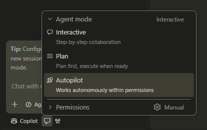
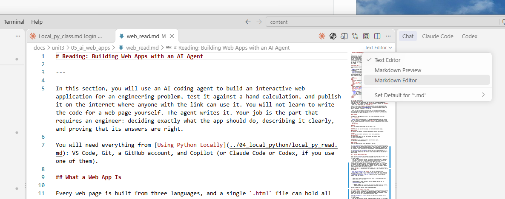
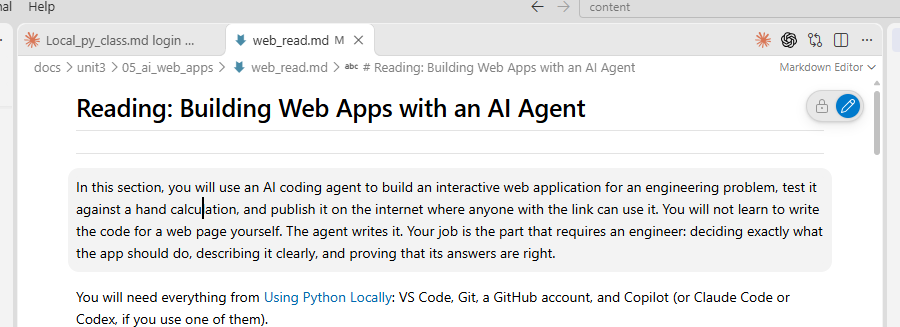

# Reading: Building Web Apps with an AI Agent

---

In this section, you will use an AI coding agent to build an interactive web application for an engineering problem, test it against a hand calculation, and publish it on the internet where anyone with the link can use it. You will not learn to write the code for a web page yourself. The agent writes it. Your job is the part that requires an engineer: deciding exactly what the app should do, describing it clearly, and proving that its answers are right.

You will need everything from [Using Python Locally](../04_local_python/local_py_read.md): VS Code, Git, a GitHub account, and Copilot (or Claude Code or Codex, if you use one of them).

## What a Web App Is

Every web page is built from three languages, and a single `.html` file can hold all three:

- **HTML** describes what is on the page: headings, text, buttons, input boxes, and drawing areas.
- **CSS** describes how it looks: colors, fonts, spacing, and layout.
- **JavaScript** describes what it does: the calculations, what happens when you click a button, and the animation.

Here is a complete web app in one file. It converts a flow rate from cubic feet per second to gallons per minute:

```html
<!DOCTYPE html>
<html>
<head>
  <title>Flow Converter</title>
  <style>
    body { font-family: sans-serif; margin: 40px; }
    input { width: 80px; }
  </style>
</head>
<body>
  <h1>Flow Converter</h1>
  <input id="cfs" type="number" value="1"> cfs
  <button onclick="convert()">Convert</button>
  <p id="result"></p>

  <script>
    function convert() {
      const cfs = Number(document.getElementById("cfs").value);
      const gpm = cfs * 448.83;
      document.getElementById("result").textContent = gpm.toFixed(1) + " gpm";
    }
  </script>
</body>
</html>
```

The HTML tags in the `<body>` put a box, a button, and an empty paragraph on the page. The `<style>` section sets the font and margins. The JavaScript inside `<script>` defines a function, much like a Python `def`, that reads the input box, multiplies, and writes the answer into the paragraph. You can read most of it with the Python you already know: `const` creates a variable, `function` defines a function, and `toFixed(1)` rounds to one decimal place like `round(gpm, 1)`.

To run it:

1. Make a folder named `flow_converter` in your class folder and open it in VS Code (**File → Open Folder**).
2. In the Explorer panel, hover over the folder name and click the **New File** icon. Type `index.html` and press Enter. The empty file opens in the editor.
3. Copy the code above into `index.html` and save it with **Ctrl+S** (**Cmd+S** on a Mac).
4. Right-click `index.html` in the Explorer panel and choose **Reveal in File Explorer** (Windows) or **Reveal in Finder** (Mac). Double-click the file there, and it opens in your web browser.

No installation and no server are required, which is why we will build every web app in this class as a **single HTML file**: it runs on any computer, and you can email it, upload it, or publish it as a web page.

A single file can still do a lot. JavaScript can draw on a canvas, animate, make charts, show maps, and download live data from public sources such as the USGS. For charts and maps, the agent can load free libraries like Chart.js or Leaflet with one line that links to a public copy online.

## The Workflow

Working with an agent goes much better if you follow the same steps every time.

### 0. Set up the project folder

A project collects files quickly: the spec, the prompt log, data files, hand calculations, and screenshots. The agent creates files too, and unless you tell it where they go, it will put them wherever it likes. Before you write the spec, set up a folder structure and write it down in `AGENTS.md`, so you and the agent both know where everything goes.

**0a. Make the project folder.** Make the top-level folder yourself, inside your class folder, for example `cce270/first_app`. Don't use spaces in folder names. Use underscores instead, as in `first_app`, because spaces cause trouble in the terminal and in GitHub repository names. Open the folder in VS Code (**File → Open Folder**) and click **Initialize Repository** in the **Source Control** panel. The agent can only work inside the folder you have open.

**0b. Plan the layout.** Use numbered folders for the supporting files, and keep the main files at the top level:

```
cce270/
└── first_app/
    ├── 00_planning/      notes, sketches, feature ideas
    ├── 01_data/          data files, such as a USGS download
    ├── 02_validation/    hand calculations and test cases
    ├── 03_output/        screenshots and exported results
    ├── AGENTS.md         instructions the agent reads every time
    ├── spec.md           what the app should do (Step 1)
    ├── prompts.md        the prompt log
    └── index.html        the app (Step 3)
```

The numbers keep the folders in order, because VS Code sorts names alphabetically. Depending on the project, you might not need all of these folders. An app with no data files doesn't need `01_data`, for example. Leave out any you don't need, and add others if your project calls for them. Always keep `AGENTS.md`, `spec.md`, `prompts.md`, and `index.html` at the top level. The agent looks for `AGENTS.md` there, GitHub Pages needs `index.html` there, and the assignments expect all four there.

**0c. Make the folders.** You can make them yourself or have the agent make them:

- **Make them yourself.** In the Explorer panel, hover over the project folder's name, click the **New Folder** icon, type a name such as `00_planning`, and press Enter. Click an empty spot in the Explorer panel before you make the next one, or VS Code puts it inside the folder you just made. Then add a line for each folder to `AGENTS.md` (create it at the top level if you don't have one yet) saying what belongs in it, so the agent knows where to save files. Git doesn't save empty folders, so a folder won't show up in your commits until it has a file in it.
- **Have the agent make them.** In the Copilot chat panel, switch to **Interactive** mode ([Step 2](#2-write-and-review-the-spec-with-the-agent) explains the modes). Edit the folder list in this prompt to match your project, then enter it:

    !!! prompt "Prompt"
        Set up the folders for this project, a single-file web app. AGENTS.md, spec.md, prompts.md, and index.html go at the top level, because GitHub Pages needs index.html there. Create numbered folders for everything else: 00_planning for notes and sketches, 01_data for data files, 02_validation for hand calculations and test cases, and 03_output for screenshots and exported results. Put a short README.md in each folder that says what belongs there. Then describe this layout in AGENTS.md, with a rule to save new files in the right folder. Don't build anything else.

    The `README.md` files tell the agent what belongs in each folder, and they keep the folders from being empty, so Git saves them.

Either way, because the layout is in `AGENTS.md`, the agent follows it in every conversation (see [Standing Instructions and the Prompt Log](#standing-instructions-and-the-prompt-log)).

### 1. Write a spec

A **spec** (short for specification) is a short document that describes what you want built. You write it in a Markdown file named `spec.md` in your project folder, using the same Markdown you have used for text cells in Colab. A good spec has these sections:

```markdown
# Your App's Name

## Purpose
One or two sentences: what the app does and who it is for.

## Inputs
Every value the user can enter or change, with units, reasonable ranges,
and the control used to enter it (number box, slider, dropdown, button).

## Calculations
The equations, rules, or logic the app uses, written out. Define every variable and its units.

## Outputs
What the app shows: numbers (with units), tables, plots, diagrams,
colors, animations.

## Look and feel
How the app looks and is laid out, what it shows when it first opens,
and how it works on a phone.

## Validation
At least one test case you have worked by hand: the exact inputs,
and the outputs the app must produce.

## Out of scope
Things the app will NOT do, so the agent doesn't add them.
```

The **Inputs** and **Outputs** sections describe the app's interface as well as its numbers. Say how the user enters each value and how each result is shown, or the agent will decide for you. For example, in an app that computes the concrete for a slab:

```markdown
## Inputs
- Slab length (ft): slider from 5 to 100 in steps of 1, default 20
- Slab thickness (in): slider from 4 to 12 in steps of 0.5, default 6

## Outputs
- Concrete to order (cubic yards), shown large and bold
- A plan-view diagram of the slab drawn to scale, with the length and
  width labeled, that redraws as the sliders move
```

The **Look and feel** section decides whether the app looks like a homework assignment or a professional tool. An agent builds as plain an app as you ask for, so describe the one you want, for example: "Clean and professional, like a commercial engineering web app, with white cards, one accent color, and an example already loaded when it opens."

The **Calculations** and **Validation** sections make the difference between an engineering app and a toy. If you leave the equations to the agent, it will pick some, and they may be wrong in ways that are hard to see. If you write them down, you can check its work.

Your first draft doesn't have to be complete. Each section can start as a rough list, such as the inputs you can think of or the equations you know you need, and you will fill in the details with the agent in Step 2. The agent is especially helpful for the **Inputs** and **Calculations** sections, where it is easy to miss something.

### 2. Write and review the spec with the agent

Now you and the agent work through the spec together until it is complete and correct.

The Copilot chat panel (the chat icon at the top of VS Code) has a mode picker that sets how much the agent is allowed to do:

{:width="400px"}

- **Plan** reads your files, answers questions, and writes a plan. It doesn't change your files.
- **Interactive** edits files and runs commands, asking your permission as it goes.
- **Autopilot** works through a whole task without stopping to ask. You won't use it in this section.

If your picker shows **Ask** and **Agent** instead, use **Ask** wherever these pages say **Plan**, and **Agent** wherever they say **Interactive**.

Do all of the spec work in **Plan** mode, and start each request by telling the agent not to build anything. You are only working on the spec, and an agent that starts writing code too early will build something you haven't finished deciding on.

**2a. Review the whole spec.** Open the Copilot chat panel, switch to **Plan** mode, and have the agent read your draft. Some questions can only be answered by looking at the whole spec at once: Is anything missing? Are these the right sections? Are they in a sensible order?

!!! prompt "Prompt"
    Read spec.md. Don't write any code or build anything. We are only working on the spec. First, tell me in a few sentences what you think the app will do. Then look at the spec as a whole: is anything missing, are these the right sections, and are they in a sensible order? Don't go into the details of each section yet.

Check that its summary matches what you have in mind. If it doesn't, your spec isn't clear yet. Fix the big-picture problems before moving on.

**2b. Work through one section at a time.** Go through the spec one section at a time, usually in order: Inputs, Calculations, Outputs, Look and feel, Validation, and Out of scope. Finish each section before starting the next. For example:

!!! prompt "Prompt"
    Let's work on just the Inputs section of spec.md. Don't build anything. Ask me about anything that is unclear, tell me if any inputs are missing, and suggest a range, a default, and a control (slider, number box, or dropdown) for each one.

!!! prompt "Prompt"
    Now the Calculations section. Don't build anything. Check each equation and its units, suggest any missing equations, list any variable that isn't defined, and tell me if any calculation the outputs need is missing.

Answer its questions and decide which suggestions to take. The agent is good at spotting a missing input, an undefined variable, or a unit that doesn't match, and it will often ask questions you hadn't thought of, such as what the slab app should do if the thickness is set to zero. It is less reliable about engineering judgment, so check any change it suggests to your equations against your textbook or notes.

**2c. Check the whole spec again.** When every section is done, have the agent read the whole spec one more time:

!!! prompt "Prompt"
    Read spec.md again. Don't build anything. List anything that is still ambiguous, missing, or inconsistent between sections, and point out anything that will be hard to build.

**Making the changes.** Because `spec.md` is a plain text file, you can change it in any of these ways, and you can mix them:

- **Edit the file yourself.** Open `spec.md`, type your changes directly, and save the file (**Ctrl+S** on Windows, **Cmd+S** on Mac).
- **Ask the agent to change it.** For example, "Update spec.md with the input ranges we agreed on. Only edit spec.md. Don't build anything." Switch to **Interactive** mode first, because Plan mode can't edit files, then switch back to **Plan** mode for the next section.
- **Leave notes and questions in the file.** This is often the easiest. Add lines anywhere in the spec, then save the file (**Ctrl+S** or **Cmd+S**) so the agent reads your latest version. For example:

    ```
    [NOTE: Should the diagram also show the thickness in a side view?]
    [NOTE: Show the volume in cubic feet as well as cubic yards.]
    ```

    The format doesn't matter, as long as you tell the agent what you did. In **Interactive** mode, enter:

    !!! prompt "Prompt"
        I added notes to spec.md in lines that start with [NOTE. Answer each question, make the changes they ask for in spec.md, and remove the notes when you're done. Don't build anything.

**Editing a `.md` file in VS Code.** When you click `spec.md` in the Explorer panel, it opens as plain text, with the `#` marks and other Markdown symbols showing. You can edit it that way. To see a formatted version, click **Text Editor** at the top right of the file and choose a different view:

{:width="700px"}

- **Markdown Preview** shows the formatted file, but you can't edit it there.
- **Markdown Editor** shows the formatted file and lets you edit it. Click the pencil icon at the top right to start editing.

{:width="700px"}

Switch back to **Text Editor** any time from the same menu.

When you're happy with the spec, commit it before moving on.

### 3. Ask the agent to build it, in stages

Don't ask the agent to build the whole app in one step. If it builds everything at once and something is wrong, it's hard to tell where the problem is. Build it in stages instead, and check and commit each stage before starting the next. A problem is much easier to fix when you know it came from the last small change.

Some parts of an app, such as the layout, a diagram, or how a plot looks, are hard to get right on paper. For those, go back and forth between the spec and the app: build a rough version, look at it, update the spec, and rebuild until it looks the way you want. Only then move on to the next stage. You still need a spec of the whole app before you start, though. The agent can only plan sensible stages if it knows what the finished app is supposed to do.

**3a. Plan the stages.** In **Plan** mode, ask the agent to help you break the work into stages:

!!! prompt "Prompt"
    Read spec.md. Don't write any code. Suggest how to build this app in 4 to 6 stages, starting with a mockup of the page layout with no real calculations. Each stage should be small enough that I can test it before moving on. For each stage, tell me what I should check when it's done.

Adjust the stages until they make sense to you. Then switch to **Interactive** mode and ask the agent to add them to the end of `spec.md` under a heading such as `## Build stages`, so you and the agent can refer to them later.

**3b. Build a mockup.** The first stage is a mockup: a page that shows what the finished app will look like, with the inputs, the output numbers, and the plots in place, but with made-up values instead of real calculations. In **Interactive** mode, enter:

!!! prompt "Prompt"
    Build stage 1 from the Build stages section of spec.md: a mockup of the app as a single file named index.html. Use plain HTML, CSS, and JavaScript with no build tools. You may load libraries from a CDN. Show every input, output, and plot from the spec, filled with realistic placeholder values. Don't write any calculations yet.

Double-click `index.html` to open it in your browser. This is the time to fix the look and layout, before any calculations depend on it. Ask for changes until you like it. Here is one example; your prompt will depend on what you see:

!!! prompt "Prompt"
    Put the sliders in a card on the left and the slab diagram on the right. Make the cubic yards to order larger, and label every dimension on the diagram with units.

When the mockup looks right, commit it.

**3c. Build the rest one stage at a time.** For each remaining stage, ask the agent to build just that stage:

!!! prompt "Prompt"
    Build stage 2 from the Build stages section of spec.md. Only build this stage. Put all calculations in clearly named functions.

Refresh the page in your browser and test the stage the way the plan says to (Steps 4 and 5 below explain how to find errors and check your answers). You can still change the layout at this point. If something is wrong, describe the problem and let the agent fix it. For example (your app may not have this problem):

!!! prompt "Prompt"
    The volume shows 133.3 cubic yards for a 20 ft x 30 ft x 6 in slab with no waste, but it should be 11.1 cubic yards. Check whether the thickness is converted from inches to feet.

When the stage works, look over the changes in the **Source Control** panel so you understand what the agent did, then commit and move on to the next stage. Asking for calculations in clearly named functions keeps them where you and the agent can find and check them.

Every change you make while building is also a change to the spec. If you ask for a new slider or a different layout and only the app changes, the spec no longer describes your app, and the agent will work from an outdated plan in the next stage. Ask the agent to update both, explicitly:

!!! prompt "Prompt"
    Change the waste factor from a number box to a slider from 0 to 15%. Update spec.md first, then change the app to match.

### 4. Run it and look for errors

Double-click `index.html` to open it in your browser. After each change the agent makes, refresh the page (**Ctrl+R** or **Cmd+R**) to load the new version.

If the page is blank or a button does nothing, there is an error. Open the browser's **developer console** to see it: press **Ctrl+Shift+J** on Windows, or **Cmd+Option+J** in Chrome on a Mac. (In Safari, first turn on **Settings → Advanced → Show features for web developers**, then press **Cmd+Option+C**.) Errors appear in red. Copy the error into the chat and ask the agent to fix it.

### 5. Validate

Enter the inputs from your validation test case and compare the app's answers to your hand calculation. If they don't match, don't simply tell the agent "the answer is wrong." Tell it what you entered, what you expected, what it showed, and how you got your answer. Often the agent will find a units error or a sign convention problem. Sometimes the mistake will be in your hand calculation.

Don't skip this step. An app that looks polished and gives wrong answers is worse than no app at all, because people will believe it.

### 6. Commit

Each time the app works and passes validation, commit. Have the agent do it:

!!! prompt "Prompt"
    Commit these changes.

Agents write clear, specific commit messages, because they know exactly what they changed. Before you ask, look over the changes in the Source Control panel so you know what is being saved, and read the message the agent writes. Then, if the next request goes badly, you can discard the agent's changes in the Source Control panel and you are back to a working app.

### 7. Add one feature at a time

Now you have a basic working app that gives correct answers. This is where you make it more useful and more polished by adding capabilities and better outputs. For the slab app, you might add:

- A selector for the slab shape: rectangle, L-shape, or circle, with the diagram changing to match
- A 3D view of the slab that you can rotate by dragging it
- The number of 10-cubic-yard trucks needed, shown as truck icons
- A cost breakdown table for the concrete, delivery, and pump truck
- A warning, shown in red, when the slab is thinner than 4 in

Come up with your own ideas, or work with the agent to decide what to add. In **Plan** mode, enter:

!!! prompt "Prompt"
    Read spec.md and index.html. Don't write any code. I want to make this app more useful to a practicing engineer and more polished to look at. Suggest 5 to 8 features I could add, such as new inputs, better plots, or drawings. For each one, explain what it adds, how hard it will be to build, and whether it would change any of the calculations.

Iterate on the plan before anything is built. Ask follow-up questions, drop ideas you don't want, add your own, and ask the agent to describe exactly how a feature will look and work, for example:

!!! prompt "Prompt"
    For the truck icons, describe what they will look like. Where will they go on the page, how will a partly full last truck be shown, and what happens when I move the thickness slider?

When you've settled on the features, add them to `spec.md` so the spec still describes the whole app. Then switch to **Interactive** mode and build them **one at a time**:

!!! prompt "Prompt"
    Add the slab shape selector described in spec.md. Only add this one feature.

After each feature, refresh the page, check that it works and looks the way you want, and make sure the validation case still gives the right answers. Ask for changes until it's right, then commit before starting the next feature. A long list of changes in one request is much harder to check, and when something breaks you won't know which change caused it.

## Tips for Working with the Agent

- **Be specific about what you see.** "The volume is 12 times too large" is much more useful than "it's broken."
- **Ask it to explain.** "Explain how the solve function works, step by step" is a good way to check that the calculation matches your spec.
- **Ask it to check its own work.** "Compare the formulas in index.html to the Calculations section of spec.md and list any differences."
- **Update the spec.** When you change your mind about how something should work, change the spec first, then ask the agent to update the app to match. The spec stays the single description of what the app is supposed to do.
- **Start over when it's stuck.** If several attempts at a fix have made things worse, discard the changes and try again with a clearer request.

## Standing Instructions and the Prompt Log

Copilot, Codex, and Claude Code all read a file named `AGENTS.md` at the top of your project folder at the start of every conversation. Anything you put there works like an instruction you give the agent every time, without retyping it. Start every project in this class with an `AGENTS.md` containing at least this line:

```markdown
- After each request, add an entry to prompts.md: what I asked, what you changed, and whether it worked.
```

The agent will then keep a **prompt log** in `prompts.md`, a running record of how the app was built:

```markdown
1. Asked to build stage 1 (mockup) from spec.md. Built index.html; the slab diagram wasn't drawn to scale.
2. Asked to draw the diagram to scale. Changed the drawing function. Fixed.
3. Validation: volume was 12 times too large because thickness wasn't converted from inches to feet. Asked to convert it. Fixed.
```

Read the log before you submit an assignment, and correct anything the agent glossed over, such as a fix that didn't actually work. The log replaces the rule from earlier homework about commenting AI-written code. Graders use it to see how you directed the agent, and it will help your team write up your final project.

You can add your own rules to `AGENTS.md` as you go, such as "Units are US customary" or "Rerun the validation cases after every change."

## Publishing with GitHub Pages

GitHub can host any HTML file in a public repository as a web page, for free. Once your app is in a repository on GitHub:

1. Make sure the file is named `index.html` and is in the top level of the repository.
2. On your repository's page on GitHub, go to **Settings → Pages**.
3. Under **Build and deployment**, set **Source** to **Deploy from a branch**, choose the **main** branch and the **/ (root)** folder, and click **Save**.
4. Wait a few minutes, then refresh the Pages settings page. It will show your site's address, which looks like `https://your-username.github.io/your-repo-name/`.

Every time you push a new commit, GitHub updates the page within a few minutes (it can take up to 10).

---

# Pre-Class Quiz Challenge

In class, you will build an app from a spec your instructor gives you, and you will write the specs for your own apps from now on. For practice, write a spec for a small app that computes the concrete needed for a rectangular slab:

- The user enters the slab length and width (ft), thickness (in), a waste factor (%), and the price of concrete per cubic yard
- The app shows the volume in cubic yards (rounded up to the nearest quarter yard, which is how concrete is ordered) and the total cost
- The app shows a diagram of the slab with its dimensions labeled

Use the seven sections from [Write a spec](#1-write-a-spec). Describe the interface as well as the calculations:

- In **Inputs**, give each value's units, range, and default, and say what control the user enters it with: a slider, a number box, or a dropdown. Choose the control that fits each value. A slider is good for a dimension you want to try many values of, and a number box is better for an exact value like a price.
- In **Outputs**, say how each result is shown (a large number, a table, a diagram) and what the diagram looks like: plan view or 3D, what is labeled, and whether it redraws as the inputs change.
- In **Look and feel**, describe the layout: where the controls, results, and diagram go on the page.

In the Validation section, work one example by hand and give its exact inputs and outputs. You do not need to build the app.

Write it in VS Code in a file named `spec.md`, created the same way as `index.html` in [What a Web App Is](#what-a-web-app-is), and upload it with your Pre-Class Quiz.

---

## Turning in/Rubric

**Rubric:**

|                      Item                      | Points Possible |
|:----------------------------------------------:|:---------------:|
| <div style="text-align: right">**Total**</div> |       15        |

---

The following is not a part of the rubric, but specifies how you can lose points. For example: if you fail to upload your file correctly.

| **Reasons for Points Lost** |    **Amount**     |  
|:---------------------------:|:-----------------:|
|  File uploaded incorrectly  |       -10%        | 
